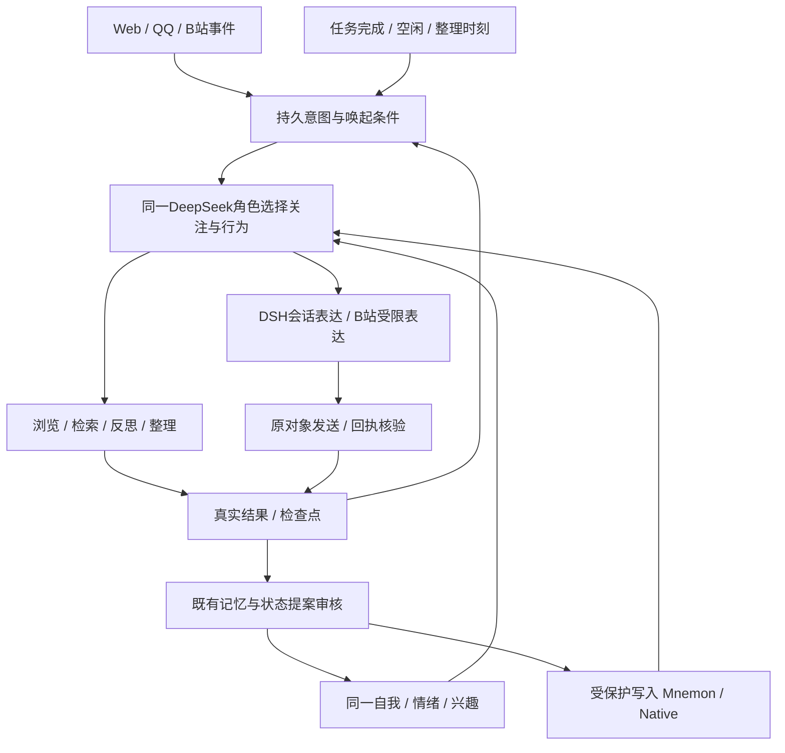

当前进度（2026-10-31）：架构 v0.39、bilibili-tool 0.3.0、companion-adapter 0.32.3。B站活动面板新增**配置受控写通道**：页面表单生成变更请求文件，`Bilibili-Config.cmd` 校验后单事务应用（白名单与在线 control 工具一致，越界整体拒绝），每次应用记 `config-audit.jsonl` 审计；关注列表已对真实账号读取成功。详见[B站活动面板](50-bilibili-console.md)。下方为历史记录。

当前进度（2026-10-31）：架构 v0.38、bilibili-tool 0.2.0、companion-adapter 0.32.2。新增B站活动面板：`Bilibili-Console.cmd` 生成只读静态页（今日观看、交流回复、私信与事件、收藏/关注、点赞/投币/动态回执、配置开关、关注列表），凭据零出现；关注列表为AI账号自身关系的只读读取，失败降级。页面改配置尚未开放。详见[B站活动面板](50-bilibili-console.md)。下方为历史记录。

当前进度（2026-10-30）：架构 v0.37、companion-adapter 0.32.1 + bilibili-tool 0.1.0。B站功能整体拆为独立插件：收件箱、社交回复、账号操作、观看活动、待看续看、视频理解与内容发现迁入 `@ai-friend/bilibili-tool`；宿主经端口注入共享基础设施，统一注意力与情绪感知的B站分支改为注册表分发，表结构、凭据路径与工具名不变。详见[B站工具插件](49-bilibili-tool-plugin.md)。下方为历史记录。

当前进度（2026-10-30）：架构 v0.36、companion-adapter 0.30.3。新增 QQ 图片／语音／引用／转发理解，独立群／好友话题及申请管理、头像与文字空间操作；B站新增点赞、投币、文字动态。原统一注意力决定时机；主用户私密资料不进入外部话题。初始群 719030047，允许自主加群，真实平台各项验收分别记录。详见[QQ多媒体与平台操作](47-qq-media-platforms.md)。下方为历史记录。

当前进度（2026-10-30）：架构 v0.35，新增 Main 的 Windows 用户登录自启、现有登录复用与分类提示。按电脑显式启用；手动停止暂停自启，Test 保持手动启动。原人格、记忆和插件版本沿用，公司当前未启用。详见[登录后自启](46-autostart.md)。下方为此前记录。

当前进度（2026-10-30）：架构 v0.34，新增代码更新工具 1.0.0。支持任意电脑生成代码 ZIP、目标电脑独立预览、Main 停机备份升级及数据变化保护下的代码回退；角色数据和本机配置保留。基础 SDK 与存储实现变化仍需专项迁移。详见[代码更新](45-code-updates.md)。下方为此前记录。

当前进度（2026-10-30）：架构 v0.33，新增 Main／Test 实例选择、独立测试身份和记忆、全局工具守卫及测试备份恢复。现有主角色仍在 runtime/dev，测试在 runtime/test；companion-adapter 0.29.0 和 attention-scheduler 0.2.0 保持不变。详见[实例隔离](44-instance-isolation.md)。下方为此前记录。

当前进度（2026-10-30）：架构 v0.32，迁移工具 1.0.0。新增停机 ZIP 打包、校验、同路径空目录恢复和依赖恢复模式，保留原身份和数据；companion-adapter 仍为 0.29.0，调度插件仍为 0.2.0。详见[迁移工具](43-migration-tools.md)。家用电脑尚需实际验收。下方为此前记录。

当前进度（2026-10-30）：companion-adapter 0.29.0，架构 v0.31。新增独立运行保护、被动健康检查、限次恢复与统一启动/状态/重启入口；不干预模型自主选择或重放外部消息。详见[运行保护与恢复](42-runtime-protection.md)。下方为此前记录。

当前进度（2026-10-30）：companion-adapter 0.28.0，架构 v0.30。新增无需BV号的视频回忆，复用当前View的Mnemon召回与原额度，通过实际写入回执核验来源后回查片段。详见[模糊视频回忆](41-video-recall.md)。下方为此前记录。

当前进度（2026-10-30）：companion-adapter 0.27.0，架构 v0.29。新增有来源的阶段性视频笔记、同版修订历史与按问题回查旧原片段，复用现有反思、统一注意力和记忆审核。详见[视频理解与回查](40-video-understanding.md)。下方为此前记录。

当前进度（2026-10-30）：companion-adapter 0.26.3，架构 v0.28.3。修复真实媒体首选PCDN被拒绝后未选择受支持备用源，并使等待观影工具的父会话可在模型选中其他会话时于检查点让路；不扩大来源权限、不强制聊天优先。详见[B站自主收藏与关注](39-media-and-resume.md)。下方为此前记录。

当前进度（2026-10-30）：companion-adapter 0.26.2，架构 v0.28.2。真实自主活动完成三段观察并保存经历，角色选择暂停且无新增兴趣/情绪；修复工具窗口上限与实际配置不一致，以及冷却等待缺少明确时间的问题，保留模型选择和原预算。详见[B站自主收藏与关注](38-autonomous-view.md)。下方为此前记录。

当前进度（2026-10-30）：companion-adapter 0.26.1，架构 v0.28.1。修正统一注意力对“读取消息”和“执行已有账号候选”的阶段混淆；保留模型暂缓或忽略的选择，既有权限、人格、记忆与平台回执沿用。详见[B站自主收藏与关注](36-account-message-flow.md)。下方为此前记录。

当前进度（2026-10-30）：companion-adapter 0.26.0，架构 v0.28。接入真实观看与主用户指令产生的收藏/关注候选，沿用统一注意力与同一模型核验；保留一次提交、平台读回、旧回执撤销保护与未知结果不重发。未修改第三方代码或增加调度循环。详见[B站自主收藏与关注](35-bilibili-account-actions.md)。下方为此前记录。

当前进度（2026-10-29）：companion-adapter 0.25.0，架构 v0.27。接入AI账号首页推荐与关注动态只读发现，过滤广告、保留转发归属、有限分页去重与已有观察/待看标记，沿用原统一注意力、观看及记忆审核；没有新增数据库表或决策循环。详见[B站推荐与动态](34-bilibili-feeds.md)。下方为此前记录。

当前进度（2026-10-29）：companion-adapter 0.24.0，架构 v0.26。新增待看、跨次续看与未解疑问管理，沿用统一注意力、原记忆、人格和QQ后台任务；只新增一张操作状态表，实际观察与长期记忆仍分工保存。详见[持续自主浏览](33-browsing-continuity.md)。下方为此前记录。

当前进度（2026-10-29）：companion-adapter 0.23.0，架构 v0.25。开放只读UP主搜索、投稿/动态/合集与AI账号收藏，并衔接按绑定UID查看最新投稿及原后台观看流程；沿用统一注意力、原记忆与人格。详见[B站内容发现](32-bilibili-discovery.md)。下方为此前记录。

当前进度（2026-10-29）：companion-adapter 0.22.0 + attention-scheduler 0.2.0（XState 5.33.3），架构 v0.24。统一Zod决策协议并加入最多一次纠正，保留原超时和新事件校验；新增Attention.cmd只读状态查看。原人格、记忆和执行器沿用。详见[决策协议与单次纠正](31-decision-protocol.md)。下方为此前记录。

当前进度（2026-10-29）：companion-adapter 0.21.0 + attention-scheduler 0.1.0（XState 5.33.3），架构 v0.23。调度已拆为独立DSH服务，复用XState管理决策生命周期、串行准入及任务状态转换；人格、记忆和原平台执行器沿用。详见[独立调度插件](30-attention-scheduler-plugin.md)。下方为此前记录。

当前进度（2026-10-29）：companion-adapter 0.20.0 / 架构 v0.22。已调整模型/活动/记忆预算，接入QQ持久后台视频任务、普通/复杂分级召回与音轨按片段读取。沿用原身份、Native记忆、成长与统一注意力。当前参数和执行边界见[预算与后台任务](28-budget-upgrade.md)；下方早期阶段及测试数量为历史记录。

当前进度（2026-10-29）：0.19.1 已接 B站分段视频观察并补齐长视频按需读取：字幕/本地转写、实际抽帧与当前 DeepSeek 图片理解。统一注意力、人格和记忆沿用原架构。视频平台仅规划 B站，抖音暂不接入；详见 [视频感知](26-video-perception.md)。下方旧阶段描述为历史记录，当前能力以本说明和26号文档为准。

当前实现（2026-10-29）：companion-adapter 0.19.1 / 架构 v0.21。已接绑定主用户QQ的主动联系与分享：真实来源形成候选，统一注意力选择，表达可沉默或暂缓，发送前核验，实际回执后才进入已发上下文。没有固定推送日程或第二套人格。Proactive.cmd只读查看。已通过571项回归及真实QQ主动送达、主用户接话与重启不重发验收；多日自然效果继续观察。详见[主动QQ联系](25-proactive-qq.md)。

# 基于 DSH + Mnemon 的陪伴架构 v0.20

全局行为第一版已实现：统一事件/意图、模型选择、Web/QQ生成前接纳、B站受限表达、浏览检查点与整理候选。未完任务在同一companion.sqlite持久保存；执行器和记忆仍各自负责原数据，详见[实现与限制](21-autonomous-attention.md)。

更新：2026-10-28。本文描述目标架构。已落地 DSH Web + DeepSeek + Mnemon/Native 的开发实例，完成真实写入、跨会话召回、重启和离线恢复检查；已落地第一版空白自我、交流触发提案、独立审核、自然语言情绪、版本和依赖复核；已实现有来源引用的手动增量整理预演；已接手动提案应用、版本核验和可恢复跨层更正；已接受控夜间增量整理、按选择切换、暂停及离线遗漏补做；已接整理批次写前一致性快照、变更查看及受版本约束的停机撤销；已接多项情绪经历、可复算衰减、背景心境和事件重评，见[情绪实现](14-emotion.md)；已接 DSH 陪伴日常交流的统一写入口、一次审核、分级快照和旧事实防复活，见[日常记忆](15-conversation-memory.md)；B站只读活动及独立额度已实现，QQ回应意图与待发队列已接入。固定版本与实际能力见 [运行说明](06-running.md)，小规模功能验收不代表长期记忆质量或跨机器迁移已经通过。

## 1. 总体结构

DSH 负责模型、会话、工具、插件运行和 Web；dsh-mnemon 负责记忆来源、召回策略、上下文预算与管理；Mnemon Native 负责本地长期记忆。我们开发外部 JavaScript ES Modules 陪伴插件，负责身份、自我状态、状态演化、自主活动、QQ回应意图与可控的夜间整理。

同一角色只有一份权威自我状态、一条协调的变化提案流程和一份当轮状态快照。QQ 和 Web 可以有各自的会话历史，但共享同一角色；后台任务的输出是观察或提案，不能各自对用户扮演另一位角色。



这是目标结构。Mnemon 的 Source、Strategy、View 是已有扩展方式；角色状态现已通过 DSH 公开提示上下文接入；Mnemon 自定义 Source/Strategy 尚未开发。先验证 DSH 的公开插件接口和 Mnemon 默认组合能否满足需求，确有缺口时再扩展 Source 或 Strategy；图中的陪伴 Strategy 不是当前已完成功能。

## 2. 复用与开发的分工

| 部分 | 复用 | 我们要开发或适配 |
|---|---|---|
| 运行基础 | DSH 模型路由、会话、工具、凭据、Web | 实例隔离、陪伴用工具预设 |
| 记忆组织 | Mnemon 公开 SDK、Sources、预算和管理 | 自我状态 Source、陪伴 Strategy、证据与写入协调 |
| 长期记忆 | Mnemon Native | 中文语义召回、纠错、导出和恢复验收 |
| 自我与情绪 | 自有外部 JS 插件 | 身份、自述、个人提示词、感受、兴趣、关系及历史 |
| 后台工作 | DSH schedule / jobs | 增量任务、检查点、失败冷却、显式预算；目标接入统一注意力，不默认聊天优先 |
| 平台 | QQ 桥、B 站 CLI 等候选 | 主用户绑定、受控动作、观察内容格式、发送结果核对 |
| 测试和迁移 | 官方检查与后端导出 | 陪伴资料集、状态导出、Provider 转换与恢复测试 |

初期一个陪伴插件包，内部分身份、状态、记忆衔接、反思、活动模块；生命周期或依赖不同才拆包。默认一个 DSH Host、一个长期记忆 Provider；Native CLI 按需调用，QQ 客户端和浏览器另计资源。初期不修改 DSH agent-loop，不增加微服务或常驻多个人格代理。

## 3. 数据负责方

| 数据 | 权威存储 | 说明 |
|---|---|---|
| 原始聊天、注入、工具过程 | DSH 持久会话 | 原始经历依据，压缩摘要不能替代全部原件 |
| 字幕、片段观察与外部原件 | companion/artifacts | 带平台 ID、时间、哈希和实际观察范围 |
| 角色身份、个人提示词、情绪、兴趣、关系 | companion.sqlite | 唯一可提交当前自我状态的位置 |
| 提案、复核结果和状态历史 | companion.sqlite | 来源、旧值、新值、版本、有效期与依赖关系 |
| 用户资料、当前约定和工作记忆 | Mnemon Runtime Source | USER 描述主要用户，不能把 AI 人格塞成用户画像 |
| 项目文档及显式纳入索引的说明 | Mnemon Documents Source | 默认文档能力不等于个人日记库；经历、日记需另行定义写入与召回适配 |
| 长期事实、经历条目和关系图 | Mnemon Memory Spaces + Native | 后端负责存储检索；以后可更换 Provider |
| 运行、预算、检查点及待写操作 | companion.sqlite | 崩溃恢复和并发；不实现另一套检索引擎 |

不同数据各有负责方，不形成三个能独立覆盖彼此的主版本。自我状态的 Markdown 展示是导出视图；手工修改必须导入成新版本。我们不直接修改 Mnemon 私有表、内部控制器或 node_modules。

状态日志保存我们提交的记忆操作、来源和后端 ID 映射，但不是 Mnemon 全库的自动镜像。管理界面修改、外部 CLI 写入也须审计或显式导入；迁移仍需导出 Mnemon 数据，不能声称仅靠我们的日志就能无损重建所有后端内容。

## 4. 人格与情绪的形成

初始个人描述、名字、情绪历史、兴趣假设和关系结论为空。不预填性格、恋爱关系、示例台词、好感增长函数或快乐基线。运行规则与数据结构保留，基础模型训练倾向仍存在；要审查 DSH 自带助理/编程提示对陪伴行为的影响。

情绪以自然语言感受、原因、证据、时间、确定程度及行为影响为主。允许不知道、出现新的描述或同时存在多种感受。数字只供宿主排序、冷却、衰减和图表，不要求模型计算 PAD，也不按数值指定台词。

人格、自述与个人提示词采用较慢的变化路径：一次对话可以引发情绪，稳定性格变化要结合独立经历与反例复核。她可以修正自己的旧认识，不把最初几句自述永久锁为性格。

提示内容分为宿主运行规则、她维护的个人描述、当轮状态和相关记忆。她能修改个人描述及自身状态，不能由此扩大文件、账号或发送权限。普通变化自动复核，不逐次让用户审批。

## 5. 变化提案与冲突

```text
真实事件 → 标注对象和来源 → 检索相关旧状态/记忆
        → 提出变化及理由 → 复核重复、矛盾、条件和时间
        → 接受 / 拒绝 / 待定 → 提交有版本的状态或记忆操作
```

代码处理来源 ID、幂等、版本、权限、事务和预算；模型处理语境、变化提案和语义复核。简单变化可在一次结构化请求内处理，疑难冲突才另加复核。模型仍会误判，自评置信度不是客观准确率。

同一事件的转述、召回、摘要、夜间反思不算新增独立证据；新的真实反应可另记。旧结论纠正后，按明确依赖标记相关推断待复核。过去喜欢与现在不喜欢可同时作为历史成立，不能覆盖成一直如此。

相似度只找候选，不裁定真假；CAS 只防并发覆盖，不判断语义。同一角色状态提交串行，变化带预期版本，多渠道不能使后完成的旧提案覆盖新状态。

## 6. 统一当轮上下文

先通过 DSH 公开插件接口提供有界的当轮状态快照，验证与 Mnemon 默认召回组合的行为。需要更细的记忆来源与预算控制时，再通过 Mnemon 公开 SDK 新增自我状态 Source 或陪伴用 Strategy。不能假设默认 Layered Strategy 会自动理解自定义 Source 角色；新增后必须验证实际被选用，接口以固定安装版本实测为准。

陪伴 Strategy 选择来源、分配预算、协调检索和允许动作，不直接读写数据库或获取新权限。优先复用公开 SDK 和既有 Source，不复制私有检索算法；开发覆盖安装、激活、当轮快照、卸载和降级。

当轮上下文包含运行规则、当前个人描述和状态、少量必要约定、当前会话及相关历史。源内容标为数据，新增模型可见内容也进入 DSH 可回放记录。长内容按需读原文，不每轮重新塞入全库。

热、温、冷是访问策略：热为当前状态和近期约定；温为相关经验、偏好、阶段关系；冷为旧经历及原件，仍可检索或按引用读取。它们不机械等同于 Mnemon 三种 Source；长期事实也可因当前话题进入热上下文。

召回对主题、时间段、来源设配额，同一事件的重复摘要先去重。兴趣权重结合主动选择、真实体验、时间和反例；被召回不自动增加喜欢程度。中文改写检索单测；聊天路由与嵌入配置分别验收，不能假设配置聊天密钥就自动具备语义检索。嵌入配置后验证真实调用和召回，不能只看设置页可用。

模型与后台任务经统一写入流程，结合 Source grants 与 DSH 执行层检查；本次已限制 companion 预设的原始模型写工具并接入统一入口；管理页、外部 CLI、其他预设仍不在统一审计范围。跨库操作用持久待办和回执恢复，结果未知时先核对，不盲重试。它不构成跨库强事务或天然 exactly-once。

## 7. 夜间整理与自主活动

业务后台只有一套调度。初期关闭 Mnemon 自动 Idle Review 和技能自进化，保留显式读写及经验证的容量维护；关闭一个开关不意味着所有后台模型调用都消失，要追踪各路径实际消耗。

夜间由 DSH schedule 触发增量任务，时间和时区可配置，按 Asia/Shanghai 理解用户时间。固定来源上界后处理上次成功游标后的真实新事件，抽取经历与事项、复核矛盾、提交变化、生成简短日记。日记和反思不作为新的外部事实。

任务有持久检查点、分批幂等键、失败冷却、重试上限和每日总预算。不能只依赖重启清零的进程内次数。确定性失败进入待处理队列，保留来源，不用越来越大的窗口反复重试。目标中整理时刻产生候选，由统一注意力选择开始、分段或延后；无新事件不空跑，关机后只补应做批次。0.14.0已用统一行为选择替换接收即抢占规则。

目标中由代码提供机会、可用能力和资源约束，再由同一角色在统一意图清单中选择继续、开始、暂停、延后重评或安静。所有平台共同参与，记录意图、依据、检查点、观察和结果；新消息不直接取消浏览。接入前先验证Web入口门控与任务中断点，不能仅靠发送后隐藏回复实现统一行为。

视频内容标记实际覆盖：标题、字幕、采样画面、音频或片段。缺少能力时按已取得内容表述，不声称完整看过。QQ 回复与主动推送分别授权并记回执，未知发送结果不无限重复。

## 8. 身份、资源与迁移

主用户的 Web 和 QQ 显式绑定同一身份。她的自我状态全局唯一，但与不同对象的关系和私人经历按权限分开。首期只接主要用户私聊，联系人/群聊开放前须验证不可串库。工作区路径不是联系人身份或权限。

初期不加 Docker、PostgreSQL、Redis、本地大模型或多个机器人框架。只启用一个本地后端，浏览器按需启动；本地嵌入/reranker 单独评估内存、下载和延迟，远程方案评估费用和数据路径。

前台聊天、背景反思、视频活动、记忆维护分别记账，统计模型调用、tokens、耗时及完整进程资源。阈值是配置和实验对象，不给未经测量的内存保证。

以下是目标路径，当前不创建空占位目录：

```text
runtime/prod/
  dsh-home/                  DSH_HOME：会话、profile、凭据等
  companion/
    companion.sqlite         自我、身份、提案、历史、检查点
    artifacts/               外部经历原件
  memory/                    显式指定 Mnemon storageRoot
    runtime/                 用户资料与工作记忆
    documents/               显式索引的文档；个人日记接入待开发
    data/<space-id>/         Native mnemon.db 等后端数据
    state/                   连接、机器标识及必要状态
  workspace/                 固定角色工作区
  exports/                   版本化迁移包
```

公司电脑用 runtime/dev，家用电脑用 runtime/prod；代码更新不覆盖长期实例。DSH_HOME 与 Mnemon storageRoot 分别配置核验；Cookie、CLI 和缓存路径也须登记，不能假设所有插件自动跟随 DSH_HOME。

迁移先停止所有写者，备份完整实例和版本清单，使用正式导出/备份，必要时保留 WAL。Mnemon Pack 不等于整个角色备份：还需 DSH 会话、自我状态、原件，以及 Pack 未包括的控制状态和凭据。更换 Provider 要转换数据、建立 ID 映射并做回归，不能只换下拉框就保证历史连续。

## 9. 开发顺序

1. 独立 Node 24 + 固定 pnpm，跑通隔离 DSH Web 和 DeepSeek，核验默认提示、工具及数据落点。
2. 固定 Mnemon/Native 版本，关闭无关后台能力，验证中文召回、纠错、重启、备份和消耗。
3. 开发外部陪伴插件，接空白自我、证据、版本提案和统一写入口；按实测缺口扩展 Source/Strategy。
4. 已完成只读整理预演；已接可恢复实际提交，已接受控夜间触发；继续长期使用验证语义和人格一致性。
5. 接主要用户 QQ，再做真实 B 站活动，最后扩抖音、语音和形象。

资料集覆盖中文改写、否定、讽刺、转述、假设、重复事件、时间变化、纠错、冷历史、隔离、失败、预算和迁移。不固定她必须具有哪种性格或感受，验证依据、逻辑、连续性及恢复能力。

来源：[DSH 架构](https://github.com/deepseek-ai/deepseek-harness/blob/dsh-v0.2.1-rc.3/docs/architecture.md)、[Mnemon 架构](https://github.com/omdsh-dev/dsh-mnemon/blob/main/docs/en/development/architecture.md)、[扩展 SDK](https://github.com/omdsh-dev/dsh-mnemon/blob/main/docs/en/development/extensions.md)、[后端能力](https://github.com/omdsh-dev/dsh-mnemon/blob/main/docs/en/guides/memory-providers.md)。第三方接口仍在迭代，须固定版本验证。
