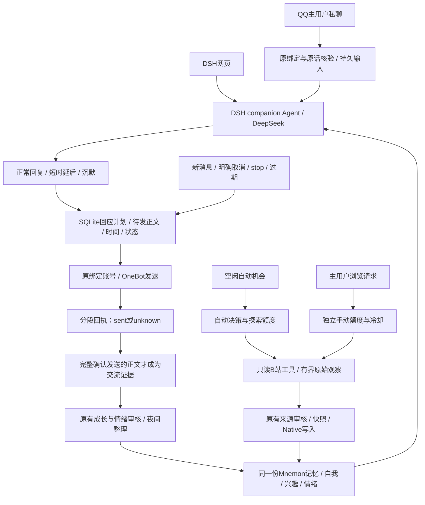

当前实现（2026-10-28）：companion-adapter 0.12.0 / 架构 v0.14。新增B站私信、@和回复通知的只读增量接收、持久队列及同一陪伴角色的受限内部处理。复用固定版本whale接入组件，未安装其整套人格和活动流程；尚不对外回复。详见 [B站事件架构](19-bilibili-inbox.md)。原QQ回应、活动预算、记忆、成长和整理继续使用；验证结果以根目录verification.json为准。

# 回应意图与活动预算：实现架构 v0.13

2026-10-28，外部插件 companion-adapter 0.11.0。此页描述实际实现和默认规则；真实验收结果见根目录 verification.json。没有改 DSH、Mnemon 或第三方已安装代码，没有另外创建一个人格或记忆库。

## 总体设计

同一陪伴 Agent 处理交流，读取共享事实、自我、兴趣和情绪。宿主负责确定接收者、额度、时间和回执；模型不能自行绕过这些约束。情绪可影响表达，但不是普通聊天的前置开关，也没有“必须先高兴才回答”的规则。



## 三类独立额度

| 类别 | 默认每天 | 冷却 | 消耗时点 |
|---|---:|---|---|
| 自动决定是否活动 | 6次 | 自动机会间隔120分钟 | 准入时；休息、失败也计数 |
| 实际自动探索 | 3次 | 随自动机会 | 选定未读视频、开始元数据/字幕读取前预留；失败不返还 |
| 主用户要求的浏览 | 6次 | 手动请求间隔30秒 | 手动任务准入；不扣上述两项 |

达到自动决策或探索任一上限就停止当天自动机会。休息只消耗决策，不消耗探索；休息仍有冷却，避免不断调用模型。手动请求不受两小时自动冷却影响，允许打断正在运行的自动活动，保留已完成步骤和回执。手动额度仍有限，避免无界运行。

额度按 Asia/Shanghai 日期保存到 activity_budget，重启不归零。activity_explorations 以运行ID去重。旧 activity_schema=1 的运行在首次升级为2时回填：所有旧自动准入计决策，明确读取或已有观察的自动运行计探索，其余手动运行计手动；旧记录原样保留，不重复回填。不把历史记录清零后重新赠送额度。

配置字段：dailyLimit（探索1–10）、decisionDailyLimit（自动决策1–24）、manualDailyLimit（手动1–30）、cooldownMinutes（自动10–1440分钟）、manualCooldownSeconds（手动5–600秒）。通过 friend_activity_control 的 configure 显式调整；friend_activity_status 与 Bilibili-Status.cmd 分别显示计数。

原有约束继续生效：自动08:00–23:00、空闲120秒、每轮180秒、最多6次活动模型调用、一轮一个视频分P、字幕最多8000字符、前台和整理优先、关机不补刷。

## QQ回应决策

普通最终正文默认正常回复，不要求额外调用判定模型。只有需要沉默或延后时，同一个陪伴 Agent 调用 friend_qq_reply_plan。该工具从当前已核验QQ原话确定消息，不接受调用者指定收件人、账号或任意旧消息。

- reply：正常生成并发送本轮最终正文。
- silent：只允许 ack / closing（纯确认或结束对话），正常记录为沉默，不冒充调用失败。问题、任务或其他类型不能以此工具沉默。
- defer：生成本轮最终正文并保存，延后5–300秒发送。默认60秒；本地可限制最大延后。到期以后默认再有效60秒，超期保留审计并取消发送。

这里的延后是“延后发送已生成的答复”，尚未实现隔几分钟重新思考、执行任务或复查外部事实。到期不再次调用模型，也不会生成新的角色或事实。

同一消息最多三次修改意图；相同意图重放不重复计次。类型由模型识别，规则能阻止已声明问题/任务的沉默，但不能保证模型永远正确理解语义，因此尚需真实使用观察。沉默不是随机抽签、情绪数值阈值或固定人设。

## 持久队列与恢复

qq_inbox 保留原消息、平台ID、DSH消息ID和回合。qq_reply_plans 保存意图、分类、理由、原话序号、最终正文序号、到期/失效时间和当前状态。qq_outbox 保留待发正文及分段状态，qq_reply_events 留下每次状态变化。

```text
原话 -> planned -> ready / scheduled -> delivered
             \-> silent
scheduled -> superseded / cancelled / expired
发送回执不明 -> unknown（不自动重发）
原回合异常 -> interrupted
```

新接收的非重复QQ原话会取代旧的未发延后答复。即使旧模型回合还没有完成，再尝试延后时也检查有没有新消息。重复平台事件不取消自己的待发答复。明确取消工具 friend_qq_reply_cancel 可从本机Web或绑定QQ取消；/stop 也取消尚未发送的回应。已开始的网络发送无法靠本地取消撤回，若后来获得完整成功回执会记录 delivered_after_cancel；多段部分发送也保留事实，不声称已全撤回。

重启读取原正文、原消息和原截止时间，不把时间向后重置，不重复调用模型。发送请求已出站而回执丢失时标记 unknown，不盲目重试；这会牺牲少量可能未收到的答复，以避免重复发送。首版没有人工重发unknown的专用入口。不是网络层“恰好一次”保证。

## 与记忆、成长和整理的关系

原始消息、工具过程及草稿继续留在DSH历史供审计。草稿、沉默、已取消和未确认的正文不能被当作“实际对主用户说过的话”。交流来源、成长上下文、整理预演和写入前证据核验都使用同一份发送权威判断：全部分段确认sent，且正文与原回合完整文字一致，才允许作为 assistant_response。

正在等待发送时，夜间扫描在该回合前保留游标；送达后再次扫描可见真实答复，取消/沉默/过期后则仅保留有效的主用户原话。主用户原话的保存意愿仍独立核验，不因答复沉默而凭空删除原话。

QQ的回复后成长审核移动到完整发送回执之后。它仍使用原消息与原回合，不取得下一条用户消息，也不增加一份新的独立经历。Web维持原来的正常回复后审核。Mnemon Runtime/Native和原有成长、情绪、快照、CAS、纠错、退休历史及停机撤销不更换实现。

安全取舍：分段只确认了一部分或回执不明时，首版保守地不把整条答复当作已说过；可能少记录部分实际发出的文字，避免把未发出的后半段当共同记忆。后续可以增加逐段发布证据，但不能把unknown自动改成成功。

## 代码及数据边界

| 模块 | 职责 |
|---|---|
| activity-config / activity-store / activities | 独立额度、迁移、预留、冷却、准入与前台让路 |
| qq-agent | 同一陪伴Agent的意图工具、明确取消及状态 |
| qq-replies | 持久计划、截止时间、状态转换、取消、过期与发布判断 |
| qq / qq-host | 原账号收发、原回合确认、回执及送达后反馈 |
| source-identity | 接收原话与实际发布的权威判断 |
| conversation-memory / growth-agent / preview-sessions / apply-evidence | 各入口一致过滤未发送草稿，并核验原件 |

代码在 plugins/companion-adapter；安装仍使用提升版本后停机运行 Setup.ps1 的原流程。新增5张表：2张activity预算表、3张QQ意图版本/计划/事件表。旧表不删除，activity_schema从1更新为2。

全部状态仍在 runtime/dev/companion/companion.sqlite，事实仍在 runtime/dev/memory，原始聊天在 runtime/dev/dsh-home。迁移时停机复制/恢复整个 runtime/dev 并携带匹配的项目源码和安装包；不能只复制 mnemon.db，也不要运行中直接覆盖SQLite主文件。平台登录可能需要在新电脑重新确认。部署前后会备份，并逐表验证旧数据，仅允许活动schema版本升级及新增预算回填。

## 验证和未实现部分

tests/qq-replies.test.mjs 检查意图约束、幂等、延后、重启、离线过期、新消息取代、明确取消、/stop、发送中取消、未知回执、发布证据与夜间游标。activities.test.mjs 检查三类额度、休息、手动抢占、上海日期和旧数据迁移。tests/response 的隔离验收使用真实DSH/DeepSeek和鉴权本机OneBot模拟器，绝不向真实QQ发测试正文。测试数量和执行结果以verification.json为准。

0.12.0已新增B站私信/@/回复的只读监听与内部处理，见19号文档。尚未实现：B站发私信/评论、主动向QQ分享、自主社交对象管理、抖音、长期目标规划、完整视频画面与音频理解，以及长期人格效果评估。自动浏览、QQ被动消息和平台社交通知是三条不同入口；现阶段前两条已落地，第三条仍待开发。
