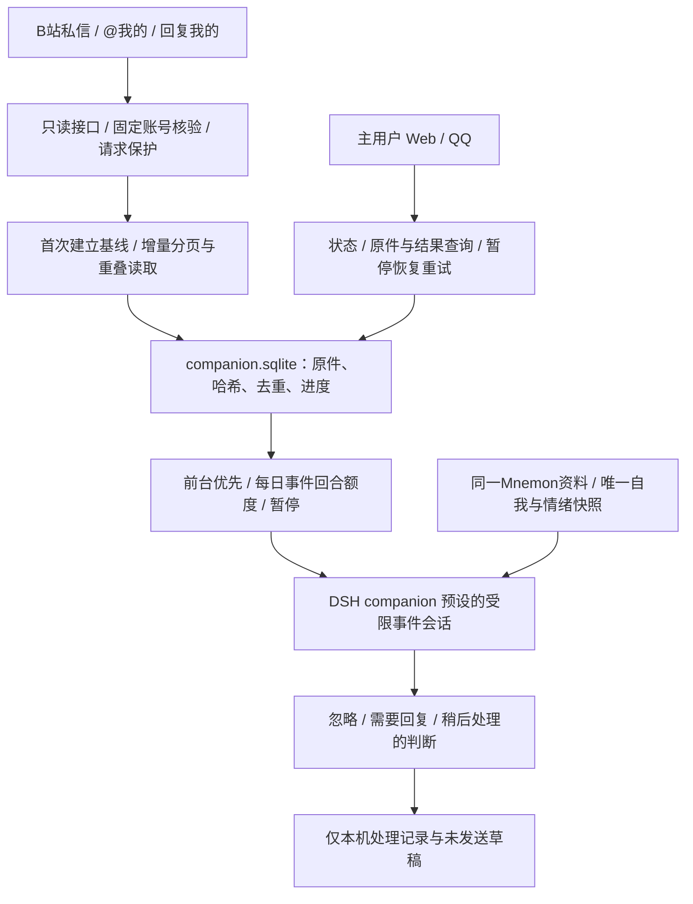

当前实现（2026-10-28）：companion-adapter 0.13.4 / 架构 v0.15。B站私信、@及回复通知现接实际回复、独立话题、受保护的交流记忆与共享兴趣/情绪提案。事件回合日上限为 0（不限）；主动探索额度独立。隔离模型验收与真实平台收发的验证状态分别记录，不能相互替代。详见 [B站交流设计](20-bilibili-conversation.md)。

以下为 0.12 的历史接收层说明；其中“内部处理、不发布”描述已由 20 号文档的 0.13 交流层扩展。

# B站私信与通知事件接入：架构 v0.14

2026-10-28，companion-adapter 0.12.1。当前实现为只读接收、同一陪伴角色内部理解和处理留痕；不向B站或QQ发送任何新通知、私信或评论。验证结果以根目录 verification.json 为准。

## 复用与开发分工

从 MIT 项目 Alterssss/dsh-bili-whale 固定提交 8b0009f8ce2ebdc421afcb2e727b19ac18912ec6 提取：无损JSON整数解析、WBI签名、私信消息规范化、实例级请求保护。许可证和变更说明保留在 plugins/companion-adapter/vendor/dsh-bili-whale 与 BILIBILI-INBOX-REFERENCES.md。

没有安装整套whale，没有引入它的默认爱好、称呼、人设、日记、随机作息或外部写工具。通知读取、分页、原评论精确核验、SQLite事件队列、来源隔离、DSH受限会话和管理工具由本项目适配。没有修改DSH、Mnemon或第三方已安装依赖；没有新增Python或独立服务。

## 实际链路

“需要回复”仅表示内部判断，当前没有发送通道。defer也只是处理意见，不会定时自动发送草稿。与QQ的已授权5–300秒延后发送是两个不同功能。

## 读取与调度

默认轮询300秒，发现新事件后下一次180秒；Host每15秒检查一次是否到期，所以唤醒不是实时推送。每个循环先向B站验证实际UID与本地账号一致，再独立读取私信、@和回复三种来源。首次成功读取各自只建立时间基线，不补处理旧历史。没有新事件不会调用模型。

通知按原始ID去重，时间边界保留60秒重叠，降低延迟可见和同秒消息的遗漏。读取进度只推进到本轮开始时的快照边界。每来源和每私信会话最多5页；积压超预算、分页不前进或请求失败时保留该来源旧进度并显示错误，其他成功来源可以继续。不会把只读到一页误报成已收全。大量历史积压超过5页的后续分片追赶尚未实现，可能需要人工处理。

评论通知仅用于发现事件。模型正文必须按评论ID及发送者UID精确回读；不采用附近楼层、不把通知标题当原话。不能核实、未知通知类型、非文字私信、正文超过4000字符或疑似密钥时隔离留痕，不调用模型。首版没有隔离条目的再次取原文专用入口。平台可见的撤回信息会使相应排队事件停止处理；已产生的内部历史保留，不表示已删除所有审计。

读取请求至少间隔1.5秒，默认每小时180次、每天2400次；事件处理取消每日12回合上限，dailyTurns=0表示不限制每日回合；每回合仍最多120秒，历史用量继续记录。显式配置1–50时仍可启用有限额度。等待前台结束的排队事件不提前扣处理额度。额度按上海日期保存，重启不归零。它们不消耗自动探索3次、自动决策6次或手动浏览6次的额度。

宿主侧失败等待从5分钟递增，最长60分钟；复用的请求保护还会在限流或登录异常时暂停实际请求。前台Web/QQ、手动浏览、记忆整理和状态审核优先；消息准备处理时可让正在执行的自动探索让路。关机期间不运行，开机后继续已持久排队事件并读取基线之后的增量；服务关闭过久且超过分页预算时会停下并报告。

## 同一角色与权限边界

每条事件使用一个可追溯的DSH companion预设会话，读取同一个Mnemon实例、GrowthController及EmotionController，完成后释放内存句柄，持久会话保留。它是同一角色处理外部事件的受限上下文，不建立另一份人格库。首版不在不同事件之间建立连续社交对话线程。

外部消息带 ai-friend:bilibili-event 来源、事件ID、原件哈希和处理尝试ID；它不会通过主用户原话核验。当前尚未绑定主用户的B站UID，所有B站发言均按外部身份处理，昵称相同或自称主人不会获得主用户权限。Web和绑定QQ仍是管理入口。

事件会话隐藏并阻断执行工具，只输出内部结构化理解、理由和可选草稿；不进行记忆、自我状态、文件、命令、平台或QQ写操作。Mnemon原有检索可能更新自身访问统计，此处“不写记忆”指不创建、更正或删除语义记忆条目，不保证数据库文件逐字节不变。原始事件留在SQLite及DSH审计，尚未接入社会交流经历的长期记忆审核流程。

这些内部assistant文字不通过“实际发送”来源核验；日常交流、成长上下文和夜间整理不会把它们当作已经对外说过的话。只有真正的主用户原话及已核实的对外发布，才能进入对应既有证据通道。

## 状态与恢复

- queued：原件已经持久保存，等待空闲和额度。
- processing：已登记唯一尝试，原输入投递到DSH。
- processed：内部结果已核验并留痕；不表示已经回复对方。
- quarantined / withdrawn：不能核实、超预算、敏感、暂不支持或被撤回的内容，不自动处理。
- failed / interrupted / cancelled：保留原件、原因和旧尝试；不会自动重复调用模型。

重启先检查原DSH回合，有完整结束记录就恢复其结果；无法确认完整处理时标记中断。主用户可以明确重试，生成新的尝试并保留旧记录，每事件最多3次，总体仍受每日回合额度约束。暂停跨重启保存。队列最多100条待处理，已满则整批不入库、不推进该来源游标，报告阻塞；不静默丢弃旧通知。

## 使用与文件

聊天工具：friend_bilibili_inbox_status、friend_bilibili_event_read、friend_bilibili_inbox_control。可说“查看B站事件监听状态”“暂停B站事件监听”“恢复B站事件监听”。重试须给出失败事件ID及明确原话。

命令：Bilibili-Status.cmd 包含只读事件概况；`node scripts/bilibili.mjs inbox-status|inbox-pause|inbox-resume` 可独立查看或控制。使用项目专用Node执行。自动探索原来的pause/resume不等同于事件监听开关。

| runtime/dev下的位置 | 内容 |
|---|---|
| companion/companion.sqlite 的 bili_inbox_* | 配置覆盖、账号绑定、三来源游标、原件、处理尝试与每日回合预算，共6张新表 |
| channels/bilibili/credentials.local.json | 沿用原独立AI账号凭据，没有另一套全局Cookie |
| channels/bilibili/inbox-traffic/ | 本实例请求计数、锁、限流与异常暂停状态 |
| dsh-home/sessions/ | 原始事件会话、运行上下文与未发送的模型结果 |

迁移仍需停机备份/恢复整个runtime/dev，携带匹配代码和profile安装包；只搬mnemon.db会遗漏角色状态、事件进度和会话。升级新增6张表，不删除或重写旧表内容；启用开关为项目自己的安装配置，不修改上游。

## 验证与剩余边界

新模块测试覆盖首次基线、重复事件、外部身份、草稿证据、前台优先、日预算、跨重启、失败游标、账号切换、队列饱和、撤回、暂停进行中的请求、并发轮询、慢请求边界与评论身份核验。真实模型验收在独立DSH/Mnemon实例使用模拟私信、@与回复通知；真实账号另做只读接口验证。结果和数量见verification.json。

真实账号读取成功不等于已验证真实新消息从平台到模型的全过程。尚待实际新私信/@检验以及长期在线观察。尚未实现平台对外回复、主动QQ分享、B站主用户UID绑定、跨事件的社交线程、外部交流的长期记忆/情绪变化审核、超大积压分片追赶、抖音和完整视听。
