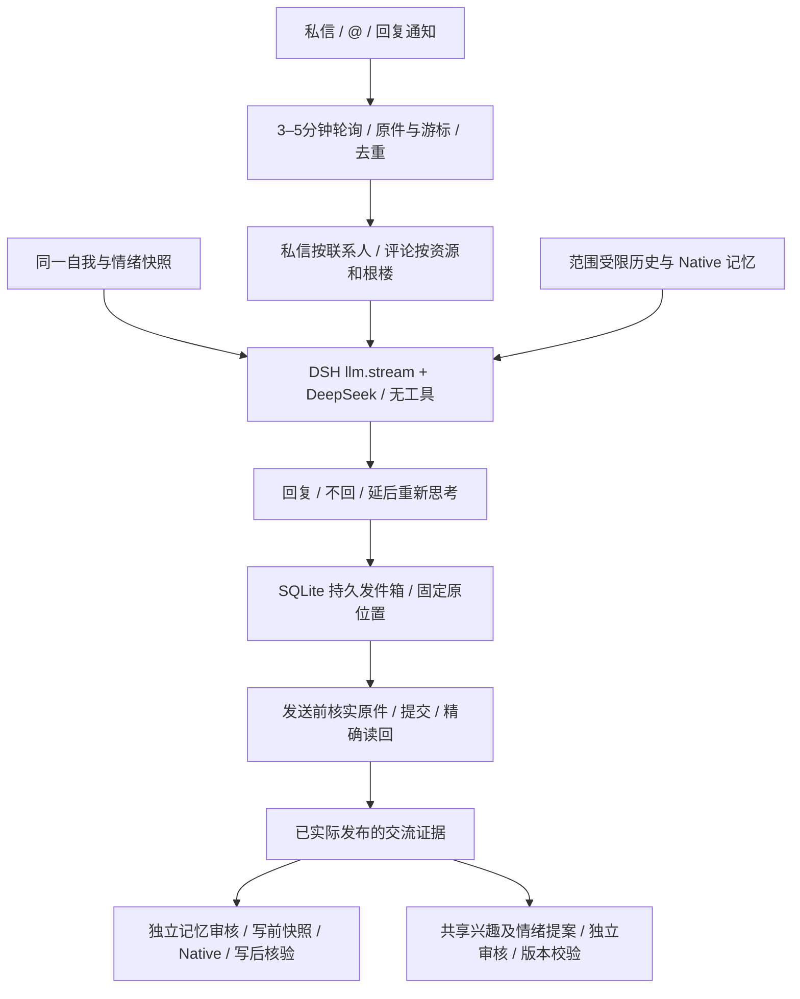

# B站交流层：companion-adapter 0.13 / 架构 v0.15

这一步在原事件接收层上增加真实私信和评论回复、连续话题、交流记忆及共享成长。复用固定版本 whale 的请求节流、精确 JSON、WBI 和消息解析；不安装另一套人格、记忆引擎或活动调度。DSH、Mnemon 及 Native 上游源码没有修改。

## 一份角色，多个交流范围

共享现有 identityId、成长状态、兴趣、情绪及版本历史，不预填新的名字、性格、关系或情绪。使用 DSH 已配置的模型路由。社交生成器是工具受限的输入/输出适配层，不维护另一位角色。

逻辑私信话题键为 AI UID + 对方 UID；公开话题键为 AI UID + 评论业务类型 + 资源 ID + 根评论 ID。两者记录在本地数据库，重启继续使用。普通私聊之间隔离，公开话题不加载主用户私密 Runtime。公开楼中参与者共用该公开话题的历史，发言始终标明 UID。

主 B站 UID `353223108` 通过本机 `channels/bilibili/social.local.json` 绑定，与已鉴权 Web / 绑定 QQ 的主用户对应。身份依据实际 UID，正文自称主人或同名昵称没有权限。主用户私信可以查询共享记忆；首版没有开放 B站操作全部 Web/QQ 管理工具，也不根据别人的消息更新全局主用户资料。

对外生成只接收程序组装的 JSON 框架：当前原话、同话题最近历史、限定范围的 Native 记录、同一自我状态和简化情绪。没有任意工具调用、任意收件人选择、系统命令或可由正文指定的发送目标。已保存的兴趣/自述也需要继续观察隐私影响；这里的隔离测试不代表对所有模型输出泄密风险的形式化保证。

## 回应和发送

正常聊天可以回复，结束性话语可以不回，需要等候时可延后 5–300 秒重新思考。最多连续三轮延后，之后保留原件待核查。连续消息合并处理，每轮取最近至多三条，较早原件保留并仍可出现在受限历史中。思考期间到达同话题新消息时，旧草稿作废。

目标由已核验的原件固定。私信只能发给原发送者；评论只能回复原资源、根楼与父评论。发送前重新读原件，核对账号、正文、位置和撤回。正文最多 800 字符，待发超过 15 分钟失效。发送时前台交互优先，开关关闭后不开始后续发送；已提交到平台的在途请求不能撤回。

发件箱状态包含 prepared、sending、accepted、sent、unknown、rejected、cancelled。HTTP 成功或 API 接受不等于已发布：只有按平台 ID 读回，并核对自己的账号、完整正文及父评论，才进入 sent / published。平台回执也不代表对方已读。accepted 只按 30 秒到 5 分钟退避读回，绝不再次 POST。发送后丢失回执、发送中进程退出均进入 unknown，不自动重发。带平台 ID 的 unknown 可人工发起只读核对。

来源队列保持每日回合不限：dailyTurns=0，使用量继续记账。主动探索的每日三次机会、手动浏览、事件回合分开。网络接口仍有限速：读取 180/小时、2400/天，发送 120/小时、2400/天，另有最小间隔、平台风控和超时；这与每天 12 个模型事件回合的旧限制不同。

## 记忆、兴趣与情绪

只有已核验发布，或明确选择不回复的完整事件，能成为学习来源。待发草稿、未知回执、未处理通知不当作自己已经说过的话。模型生成的 memory、interest、emotion 只是变化提案；回复在前、审核提交在后，不能提前声称已经长期保存或已修改状态。

社交事实仍存进同一个 Mnemon Native。写入是新增有 UID、时间、私密/公开范围、逐字原话与实际回复依据的交流经历，通过原有 ApplicationController、独立模型审核、写前快照和写后核验。对方自述保持归属和未独立核实的标记；这里不覆盖旧事实、不修改全局用户画像。索引只保存 Native ID、正文哈希、话题和应用批次引用，没有第二套事实库。

非主用户及公开话题只召回同话题索引允许的 Native 记录；原件撤回、Native 删除或正文被修正后，旧索引不再注入。主用户在自己的 Web/QQ/私信可能回忆这些经历。Native 的全局后端并非逐条带访问控制的数据库，隔离依靠受限读取框架，不向外部用户暴露全库工具。

兴趣和情绪进入已有共享成长系统，由另一轮模型审核，并使用思考开始时捕获的版本进行 CAS，避免覆盖随后发生的变化。允许审核拒绝，正常聊天无需每轮产生情绪。没有默认人物模板。明确“不保存、不学习”和接入/收发测试抑制记忆与成长提案，但原始渠道日志仍保留供连续聊天和故障排查。

## 数据、迁移与管理

- `runtime/dev/companion/companion.sqlite`：原接收原件/队列，加八张 social 表保存话题、回合、发件箱、影响回执及 Native 引用。旧表及原角色身份不重建。
- `runtime/dev/memory`：原 Mnemon Runtime 与 Native 长期经历。
- `runtime/dev/channels/bilibili`：登录凭据、主 UID、稳定设备 ID 所需状态及请求节流记录；设备 ID 本身在 social_meta。
- `plugins/companion-adapter`：可版本管理的外部插件源码；运行安装包在 profile 的 `.friend-packages`，不直接编辑运行目录的 node_modules。

迁移仍需先停机、备份并复制完整 runtime 实例，代码使用相同版本，然后 Setup 安装、启动。不要只复制 mnemon.db；其余角色状态、话题、发送回执、UID 和日志同样关系到连续性与防重发。未知发送不会因换机器自动补发。跨机器实机迁移尚未验收。

主用户在 Web/QQ 可查询 `friend_bilibili_inbox_status`、`friend_bilibili_event_read`，可通过 `friend_bilibili_social_control` 暂停/恢复发送、明确重试失败的学习步骤、只读核对带 ID 的未知回执。原监听开关控制接收与后续处理，单独暂停发送不会清空原件。离线状态无法完整判断运行中配置，应以在线状态回执为准。

## 验证与边界

独立单元/回归检查覆盖账号和目标固定、隐私框架、连续聊天、合并、去重、自己消息回显、版本冲突、延后、取消、发送未知、读回退避和重启。隔离验收使用真实 DSH、DeepSeek、Native 和快照，但 B站原件及发送为本地模拟。兴趣/情绪验收中的可选提案使用明确标记的测试夹具，审核器仍是真实模型，允许拒绝；不把它描述为自然自发情绪。

真实账号的 UID/登录只读检查、真实私信收发、真实评论收发分别记录，结果以根目录 verification.json 为准。只有用户配合产生新消息并确认后，才标记真实端到端通过。首轮建议写明“接入测试，不保存记忆”，避免测试经历进入角色长期状态。

暂未实现：图片/语音/视频画面理解、主动给陌生人私信、私信主动分享、动态投稿、点赞关注、全站主动社交、抖音。超过五页的历史接收积压仍保留游标并报错，不伪装已追上；大规模积压分段追赶和长期风控观测留待后续。原件暂时无法读回时保留待发/核验状态，不宣称发送成功。

### 0.13.1 接收修复

真实接口返回的 session_ts 是微秒，消息 timestamp 是秒；接收端现在按各自单位比较。0.13.0 错把消息时间除以一百万，导致新私信被过滤。原分页单测也错误使用了微秒消息夹具，现已改为秒，并增加真实字段格式的入队/模型输入、排除旧消息与自己回显、慢读取游标测试。已有游标在修复前停机保留，因此本次无需重置或导入旧聊天即可补读已发送的测试消息。真实收发状态仍以 verification.json 为准。

### 0.13.2 公开可见性与待核验回执

真实公开测试出现平台受理、AI 自身能读回，但未登录读取和主用户都看不到的情况。只凭该回执不能判断具体平台审核或限制原因，也不能称为公开送达。现在评论除了身份、正文和父评论的精确核对，还必须用不携带 Cookie / Authorization 的读取确认原评论位置可见。游客读取失败或没有该评论，都不进入 sent / published，不进入已发送历史或学习来源。私信仍按精确消息读回校验，已经通过两轮主用户实测。

受理后只做退避读取，不重新 POST；连续八次核验未完成后进入 unconfirmed，停止自动检查。可按平台 ID 人工发起只读 reconcile。旧版只有自身读回证明的公开 sent 记录在启动时迁移到 unconfirmed，保留平台 ID、正文和旧回执，退出“已公开”历史；私信状态不变。本次旧公开测试的学习步骤为 skipped，未产生需要回退的长期记忆或成长。

未登录可见性检查也不是所有账号可见的保证，平台审核可在之后改变。真实公开 @ 和直接回复通知的端到端验收目前未通过，不以私信通过或模拟通过代替。对当前测试不重复发评论，下一步需确认平台允许该账号正常公开发言，或在主用户管理的测试位置继续受控验证。

### 0.13.3 评论 Web 请求补齐（实发效果待验证）

主用户手动对照确认：同一 AI 账号在同一视频下的“牛的”一级评论状态为 0，游客可见；原程序楼中楼回复仍为 17，游客不可见。它们内容、层级和提交上下文不同，因此尚不能证明具体原因。比对 Alterssss/dsh-bili-whale 的 tools/commands/comment.mjs 后，补齐评论 POST 的 WBI 签名、Origin 和资源 Referer。视频使用按精确 aid 构造的 av 页面地址；文字动态使用其 ID，图文动态缺少动态 ID 时使用动态站点根地址，不捏造 ID。签名 URL 只放 w_rid/wts，正文、CSRF 和 Cookie 不写入 URL。没有伪造或轮换设备身份，也不自动重发旧评论。

API 受理回执额外保留平台返回的 state / success_toast 诊断字段；这些字段不代表公开可见，仍须通过 0.13.2 的精确读回与游客可见性检查。此补丁仅改 package.json 和 bilibili-social-client.js，其他 100 个插件文件逐字节不变；当前 HTTP 专项与完整回归另记，真实模型 14 场景沿用 0.13.2 的明确历史证据，不冒充重跑。新请求能否解决不可见问题仍需一个新的已授权入站测试事件。

参考：[whale 评论提交源码](https://github.com/Alterssss/dsh-bili-whale/blob/8b0009f8ce2ebdc421afcb2e727b19ac18912ec6/tools/commands/comment.mjs)。

### 0.13.4 正常网页会话与真实正文

独立Chrome网页与手机App手动发送都能公开可见；0.13.3仅补签名等字段后，实际“收到”仍仅自身可见。B站网络接口禁用缓存后的对照显示程序与浏览器当时为同一IPv4出口，首轮未控制缓存的差异不作为根因证据。没有修改全局代理、IP或系统网络设置。

当前只在评论POST复用本机正常网页已生成的会话Cookie与User-Agent，按捕获的正常请求补gaia_source、statistics及身份绑定的回复前缀/at映射；视频Referer通过已核实aid解析为BV页。没有生成假设备标识，没有复制浏览器指纹查询字段，也没有绕过登录、验证码或平台限制。网页会话属于账号凭据：运行时web-session.local.json绑定AI UID及原SESSDATA哈希，禁止不同账号/令牌混用，过期票据不发送；必要设备信息缺失时停止评论提交，私信继续独立运行。

新增 Sync-Bilibili-Web-Session.cmd，用已授权本机登录打开独立Chrome/Edge正常网页、同步会话，再关闭专用窗口；如平台要求验证，用户在网页完成后重试。没有常驻浏览器依赖。同步只记录本机B站会话，值不写日志；捕获工具对评论请求只保存白名单字段。迁移仍复制完整runtime；换登录或会话失效时重新同步。浏览器缓存位于.work，不属于人格或长期记忆。

平台可能把正文“收到”展示成“回复 @昵称 : 收到”。只接受原评论作者UID、父评论ID、根楼、AI UID及逐字正文共同匹配的已知前缀，且游客与账号读取的实际正文必须相同。将真实正文写入回执、对话历史及来源依据，模型草稿另保留。不会用任意截断、包含关系或猜昵称来放宽验证。旧未确认评论不重发。

这些改动能否解决当前实际不可见问题仍须新入站事件验收；真实网页手动成功、模拟通过、API受理均不替代自动公开送达验证。

本机实测进度（2026-10-28）：0.13.4已有两条真实楼中楼程序回复通过独立游客核验，回复ID为322167937952、322168210976，且第二轮准确接续“新的对照收到”。实际平台前缀已进入回执与来源，两轮学习步骤均为skipped；旧失败回执仍为unconfirmed，未补发。主账号已确认这两轮均可见；随后顶层@回复322169703136也通过游客核验与主账号确认。本轮真实收发验收完成，状态以verification.json为准。补齐会话和多个提交字段后本轮通过，未做逐字段对照，不能唯一归因某个Cookie、签名或IP。

### 最终真实验收范围（2026-10-28）

已确认：绑定主用户两轮B站私信；两轮公开评论接续；新顶层@接收与公开回复。三个新版公开回复都经游客与账号独立读回，并由主账号确认可见。私信真实验证发生在0.13.1，评论会话和顶层@在0.13.4；当前407项回归与14个模型隔离场景覆盖0.13.4。所有本轮测试的学习步骤跳过，Native与人格未吸收这些测试；两条旧失败回执保持unconfirmed，未重发。

这是一位主用户、一个AI账号、一个主用户视频的文字场景功能验收，不代表已验证多人长时间使用、任意账号可见性、长期记忆质量或情绪/人格演化质量。日常可开始正常聊天；更换登录或网页会话失效时使用Sync-Bilibili-Web-Session.cmd同步，平台若要求验证则在正常网页中人工完成。具体哪一个会话字段导致原故障未作单变量实验，不作唯一归因；禁用缓存后的出口检查没有发现当时IP不同。
