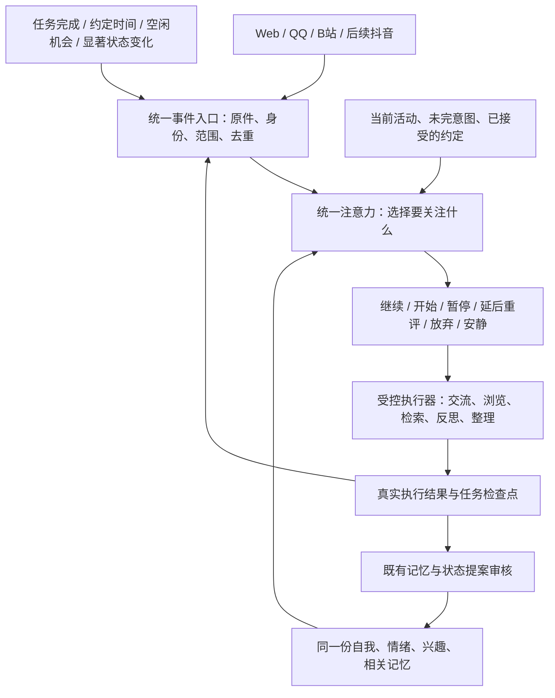

# 自主注意力与行为调度：方案评估

更新：2026-10-28。companion-adapter 0.14.0已实现第一版全局行为闭环。前半保留设计与参考，实际完成范围和限制以下文“0.14.0实现”一节为准。身份、旧记忆、登录与原有明确额度保持连续。

## 需求修订

消息及时进入感知范围，与她是否回应是两个独立问题。用户明确要求取消“聊天天然优先”的产品假设：她可以继续浏览或手头任务，稍后再想，也可以不回复一个普通问题。收到消息不自动中止当前活动，不将沉默判作任务失败。

她依据同一份自我、兴趣、情绪、真实当前活动及目标选择下一步。情绪是决策依据之一，不用“愉快值过阈值才回复”或固定概率沉默代替语境判断，也不为了表现自主而刻意拒答。

注意力选择与账号权限分开。主用户身份决定可访问哪些资料及管理工具，不代表每条聊天必须抢占她的注意力。用户的停机、暂停及权限设置仍由宿主直接执行。

## 查询到的现有方案

| 参考 | 可以借鉴或复用 | 适配判断 |
|---|---|---|
| [Cortico 设计原则](https://github.com/Pal-AI-Lab/Cortico/blob/main/PHILOSOPHY.md) | 事件流、多环境输入、运行机制与行为语义分离；允许不采取行动 | 最贴近本次目标，但它是完整运行框架，不是 DSH 插件。没有在本实例验证整框架嵌入；建议借鉴架构，不并行运行两套人格/记忆权威 |
| [MaiBot 模型与规划器配置](https://docs.maibot.chat/manual/configuration/model-config) | 规划器决定何时说话、调用什么工具，发言生成另有职责 | 有实际聊天系统参考。完整系统有多类模型调用，直接搬入会增加运行和集成成本；使用其决策分层思路，不导入默认人物模板 |
| [MaiBot 自主日程插件](https://github.com/xuqian13/autonomous_planning_plugin) | 活动快照、未来约定、日程生成与注入接口 | 依赖 MaiBot；README 的日程包括吃饭、睡觉等模拟生活，不等同于真实工具任务。可以参考任务接口，不直接采用默认日程作为本角色经历 |
| [XState 状态持久化](https://stately.ai/docs/persistence)与[延时事件](https://stately.ai/docs/delayed-transitions) | 状态切换、等待、暂停/恢复及快照机制 | 是通用工程库，不会自己产生意愿。可选复用，优先评估现有 SQLite 调度能否承载，避免重复权威存储；恢复会重新启动部分调用，不能代替当前发件箱防重机制 |
| [Generative Agents 规划源码](https://github.com/joonspk-research/generative_agents/blob/main/reverie/backend_server/persona/cognitive_modules/plan.py) | 观察事件后决定交谈、等待或维持当前计划 | 是研究模拟与参考代码，不是可直接接入 DSH 的生产插件；不照搬模拟世界中的生活行为 |

MaiBot 的[公开 Timing Gate 问题记录](https://github.com/Mai-with-u/MaiBot/issues/1762)提供了 continue/wait/no_reply 的实际历史示例；这是历史实现证据，不用来宣称当前版本完全相同。Cortico 的“记忆与身份连续性”属于其设计立场，不作为更换模型后行为必然一致的保证。

结论：所查项目提供了可参考的工程机制，但没有核实到可直接安装进当前 DSH、同时满足三平台、统一状态、真实活动和自主回应的完整插件。推荐复用现有组件，在 companion-adapter 中实现统一注意力协调层。没有必要重写 Mnemon，也不为本需求额外部署另一套机器人框架。

## 全局行为架构：所有渠道与活动共用

用户于2026-10-28进一步明确：该机制覆盖全部自主行为，不只控制B站回复。以下是待开发设计，未修改运行代码。这里的“全部行为”指角色的语义选择；事件落盘、数据库一致性、发送核验、停机和权限执行仍由程序可靠完成，不交给情绪决定是否履行。

### 1. 一份自我、一份意图清单、一处行为选择

渠道只负责收发与平台适配，不自行决定“消息来了必须打断什么”。B站、QQ、Web、浏览和夜间整理都向同一协调器提交事项。既有状态审核器负责验证变化，不成为各自有性格和目标的角色。

意图清单是可恢复的工作记忆，保存她在意的事情、当前活动、未完任务、明确接受的约定和自行提出的探索目标；不是第二套人格或长期记忆数据库。目标可以来自真实交流、活动后的好奇、未解决的问题或回忆，可以修订、暂停或放弃。用户发出请求、她看见请求、她接受承诺是三个不同事件。

没有新消息时也可行动：约定到期、任务完成、她安排的考虑时间以及有界空闲机会都能唤起选择；她可以读旧记忆、探索感兴趣的话题、提出想法、主动联系已获授权的对象，或者继续安静。空闲机会不强迫生成目标，不安排虚构的吃饭、上课等人类生活日程。

### 2. 决策依据与行为集合

选择时提供有界快照：当前自述与个人提示词、自然语言感受和背景心境、相关兴趣/关系、真正进行中的活动、待关注事项及已接受的约定；需要细节再检索原件与相关长期记忆。不每轮扫描全库，也不让所有平台的完整私聊进入公共回复上下文。

模型选择语义，代码核验动作存在、范围与权限合法、版本未过期、任务状态允许转换。可以包含以下行为：

| 选择 | 含义 |
|---|---|
| 继续 | 保持当前阅读、交流、回忆或整理，不因新消息自动切走 |
| 开始 | 从可用能力中发起交流、浏览、检索、反思或整理任务 |
| 暂停并切换 | 保存原任务检查点，在可中断位置切换，之后可恢复 |
| 延后重新考虑 | 保存事项和唤起条件；条件满足后重新判断，不自动发送旧稿 |
| 结束或放弃 | 明确结束某个意图，保留历史；不将无回应当作技术失败 |
| 安静 | 暂不开始新活动，可以等事件或自行选择的下次考虑时刻 |

情绪、关系、任务投入和约定是语境因素，不预设“聊天比视频重要”“主用户每句都优先”“高兴才回复”等公式。已接受的约定应在再决策中可见；重评或放弃留下记录，不通过硬编码强制履约，也不静默丢掉。

### 3. 同一注意力不等于所有执行串行

首版协调器串行提交关键行为选择，绑定状态版本和活动版本；选择后执行任务，执行结果再次成为事件。多个渠道接收、网络等待、必要的存储维护可以并行，不用一把锁把整段浏览或模型请求全部占住。启动或切换前再次核验版本，过时决策先重评。

浏览与整理需要明确可中断点。暂停发生在读取/分析的小步骤之间、整理批次边界；写事务、已发出的网络请求、发送结果未知的操作不能靠取消信号当作没发生。继续沿用现有发送核验、未知不盲重发和写前保护。

长请求期间也要接收入库新事件，但不把每个通知都当强制抢占。缺少可恢复执行能力的工具应标记“只能完成或终止”，不能宣称可以原地恢复。

### 4. 跨平台连续性和信息范围

所有平台共用相同identityId与权威状态。各话题保留独立的对象、可见范围和原件；统一的是注意力和行为协调，不是把全部聊天混成一段会话。发往公共场合的表达须重新构造受限上下文，不能直接复用含主用户私聊的决策草稿。

分开记录：平台已收到、已呈现给角色、已读取到什么范围、选择延后/不理、拟发送、实际发送及外部可见性。只收到通知不等于已经读完，生成回复不等于已说出口。用户询问状态时可以看到简短摘要；角色正常交流不需要不断播报内部调度。

不回复仍可能形成真实的观察或情绪。例如看见一条消息但选择不答，来源是该真实消息；草稿和未发送内容不能记为双方共同交流。不得把重复反思当新增独立证据；接入此路径时需补充现有来源与审核规则，显式“不保存记忆”规则继续适用。

### 5. 反思、记忆整理与技术维护

自主回忆、情绪重评、个人描述/兴趣修订及记忆的语义整理，都纳入统一意图与注意力选择。是否关注、何时开展、要检索什么由她选择；实际状态和长期记忆的提交仍经既有证据、版本和审核流程，不能绕过保护直接自改。

既有02:00夜间时间在目标方案中表示“产生一次整理候选”，不再天然抢占，也不意味着强制睡眠。可以当晚整理、延后或分段做，进度和待处理范围必须可恢复。无新资料不空跑。

日志落盘、一致性快照、数据库恢复、权限检查和宿主停机是可靠性职责，不能因为她不想整理而停掉；语义整理暂缓也不能导致原始经历丢失。该目标尚未替换当前夜间定时逻辑。

### 6. 轻量实现与数据归属

继续在companion-adapter中开发，不增加独立常驻人格进程。目标模块为事件/意图存储、行为选择器、任务协调器和已有执行器适配。可优先使用现有SQLite事务、jobs、计时器；只有状态转换复杂度证明有必要时才加入XState，不先引入第二套状态持久化。

| 数据 | 目标存放 | 边界 |
|---|---|---|
| 自我、情绪、兴趣与版本 | 既有companion.sqlite状态模块 | 保持唯一权威 |
| 事件索引、意图、选择摘要、唤起条件和任务引用 | 同一companion.sqlite新增命名空间 | 原件继续引用既有渠道/会话记录，不拷贝成独立真相 |
| 任务执行与发送状态 | 既有activity/jobs、渠道inbox/outbox及检查点 | 协调层引用原执行ID，不另造相互覆盖的回执 |
| 长期经历与事实 | 既有Mnemon/Native | 通过现有受保护写入口 |

决策日志只保存选项、所依据的事件/状态版本、简短理由、后续条件与结果，不保存冗长的内部推理链。没有新事件或到期条件时不持续调用模型；合并同一话题的连续提醒并保留原件，防止提醒洪水造成重复调用。维持dailyTurns=0；资源并发、冷却及平台限速是显式运行约束，不暗设每日12回合。

待考虑事项有“等待”“待重评”“已结束”“失败”等独立状态。到期只触发重评，过时事项可以结束，不强迫补回每一条消息；反复延后可合并唤起、明确休眠，避免每分钟重新犹豫。模型失败或未能解析应记录为故障，不伪装成她主动无视。

### 7. 接入顺序与验收

1. 先验证DSH公开接口能否在Web/QQ请求开始前接入统一入口，以及任务能否分步暂停。当前源码已验证session/event通知与agents创建/恢复，不据此声称Web发起前门控已经存在；若原生入口无法拦截，应明确选择自有陪伴入口或最小上游扩展，不只在回复生成后隐藏文字冒充已经统一。
2. 引入事件/意图持久化与统一选择，先做影子运行，与现行执行隔离；其输出不发送、不写角色长期记忆、不触发成长。
3. 接入QQ、Web、B站的回应选择与真实浏览执行，移除各自硬编码的抢占和强制回应规则，保留平台发送核验。不能只改B站便宣称全部行为统一。
4. 接入自主空闲选择、任务恢复、回忆/反思、整理候选；主动联系复用同一决策，但只有实际授权并实现的执行器才能发送。当前QQ主动分享未开发，不能在本设计中标为已开放。

验收覆盖：正在浏览时收到QQ或Web消息仍可继续；正在交流时也可选择先查资料、暂停或不答；任务完成后重新考虑另一平台事项；无消息时能选择真实活动或安静；延后重评使用新状态而非旧稿；跨重启保留未完意图但不重发；跨人和公私范围不串；不回复不伪记成已交流；整理选择可推迟而原件和一致性保护继续有效。机制测试验证各合法选择可执行，真实模型测试评价理由与连续性，不把“必须忽略用户一次”作为人格验收标准。

首版提供当前活动、待考虑事项、已暂缓/结束原因和近期选择摘要的只读查看。后续再评估多日目标和更复杂的并发任务，不承诺仅靠统一调度就能形成长期一致的人格。

## 推荐的最小流程

1. 接收事件并保存原件，产生“可感知的新事项”，保留话题与隐私范围。
2. 同一角色读取当前活动、自己的状态、待处理事项和必要上下文，选择立即回应、继续当前活动、稍后重新判断、或本轮不回应。
3. 需要回复时，重新按目标话题构造受限上下文，再生成和核验发送。统一注意力不等于把所有人的私聊合在一个公开回复上下文中。
4. 延后等待任务结束、约定时间或值得重新判断的状态变化；到时重新决定，不能强制发送旧草稿。不回应是正常业务结果，不进入失败自动重试。
5. 只记录简短决策摘要及可验证活动结果。内部反复思考不是新增外部证据，不据此不断强化性格或关系。

新消息、任务完成、显著状态变化和她选择的下一次考虑时刻可成为触发源。无需每秒调用模型来表演思考。实际浏览、读取和工具执行必须有真实记录；没有执行过的吃饭、上课、视频观看不能写成已经发生的经历。

## 当前代码的具体缺口

- bilibili-inbox-host.js 的 beforeWake 会中止自动浏览，busy 也会阻挡部分回应决策；需要让注意力决策参与权衡。
- qq-agent.js 和 qq-replies.js 只允许确认/结束型消息沉默，普通问题或任务不能沉默；与新需求不同。
- QQ defer 保存现成正文，到期发送；需要区分“稍后再思考”与“延后发已有文字”。
- B站已有 reply/ignore/defer，但延后上限5–300秒、同事件三轮后中断；尚不能完整表达“先做完这项任务，再决定理不理”。
- 已有兴趣、情绪、夜间整理和活动决策可以继续复用；跨渠道统一注意力、任务继续/恢复和对应可视化尚待实现。

## 实现边界与验收

继续沿用同一个 identityId、自我/情绪权威、Mnemon 记忆与发送回执。事件回合保持 dailyTurns=0，不以改名重新增加每天12回合限制；平台请求限速及原有活动预算继续明确执行。

需要验证：新消息不必抢占活动；普通问题可以沉默；决定延后后可继续做事；任务结束或状态变化后重新判断；状态已变时不发旧草稿；重启保留待考虑事项且不重发评论；未回应的内容不被误记为已发送；跨人和公开/私聊范围不串入上下文。

工程上可行，推荐先落小范围行为集合。长期是否形成连贯、可信的自主行为，仍需正常使用资料验证，不能由一个插件名称、固定概率或一份日程证明。

## 0.14.0实现

使用现有DSH公开agent/pre-step接口，在Web和QQ生成回复前保存原始已识别消息，由同一DeepSeek角色选择。暂缓/沉默时返回reject，阻止时间等上下文插件补入内容后误触发开场白；DSH技术回合以blocked收束，业务意图分别记为waiting或dismissed，不视为模型故障。

实现文件：attention-store.js负责四张attention_表，attention.js负责选择与版本核验，attention-reviewer.js负责结构化模型接口，attention-host.js对接真实平台/任务，attention-agent.js提供主用户只读状态工具，activity-attention.js负责浏览检查点和暂停。全部属于现有外接插件，没有修改DSH或Mnemon安装源码。

- Web/QQ原消息连同消息ID、来源和原会话持久保存。唤起后重新选择；重启不另造原话。已经进入原会话的消息先核对，不能因回执不完整而重复生成。
- B站入站事项保留原话题/对象范围。全局选择关注后再构建受限表达框架；不把全局私密决策上下文直接用作公开回复。原有实际发送、原位置读回与游客可见性检查继续执行。
- 浏览可以在工具步骤之间暂停，并以同一runId恢复；暂停时间不计入执行超时。已保存的观察、反思及写入回执用于恢复，不重新增加浏览准入次数。进程停止保留未完意图，用户主动取消则明确结束。
- 夜间时刻产生整理候选，经全局选择后使用原增量批次和检查点执行。接收消息不再自动中止浏览或让整理退出；选择切换时才让出可恢复工作。
- 自主检索和反思形成工作记录，不作为新的独立外部证据自动强化人格。意图建议需作为后续候选再选择，不能通过建议直接调用任意发送工具。
- 资源未到可切换点时，事项进入等待，完成后用新状态重评，不在队列末尾自动执行旧决定。选择期间出现新事件或状态版本变化时，过时决定不能直接提交。
- 原dailyTurns=0保持不限。浏览额度、API限速与原调用预算独立；没有新增隐藏每日12回合限制。默认无固定睡眠时段，空闲机会可以选择安静。

### 本版边界

已经在执行的模型请求与不支持中断的工具需要到结束或检查点才切换；首版只支持一个未完浏览执行任务。DSH原生会话的已接纳中断回合先核对而不盲重播，不宣称任意半轮模型推理都能原地恢复。多日目标、任意工具分步恢复、QQ自主发送与抖音仍待开发。B站接收轮询没有提速。

intent/decision/checkpoint与原自我共存于runtime/dev/companion/companion.sqlite；长期事实继续在Mnemon/Native，平台原件和回执沿用原表。迁移仍按停止写者、备份完整runtime实例和固定插件版本执行。只复制长期库不能带走未完意图。旧版本不理解attention_waiting；回退前需保留/导出未完事项，不能假定旧代码会处理新状态。

验证分开记录：机制用例控制合法选择，验证每条执行路径；真实DeepSeek选择另用隔离状态验证可执行输出，不规定她必须有哪种情绪、必须回答或必须忽略某条消息。真实平台对外送达沿用此前验收，本轮新增测试不向生产QQ/B站发消息。详细结果见项目verification.json。

### 最终验收记录

0.14.0：实际安装包的426项回归通过，27项独立DSH/DeepSeek/Native验收通过，其中4项直接验证真实DeepSeek行为选择，其余控制选择验证执行路径。测试使用模拟平台，生产记忆文件未被测试改动。正式安装前后身份、原有74张表及记忆/登录配置校验通过，新增4张attention_表；QQ实际登录只读核验通过。

0.15.0已补充沉默感知后的可选情绪提案与自主重评，复用原审核和版本保护，见[感知与情绪](22-perception-emotion.md)。长期行为质量、未完事项规模和多日目标仍需后续正常使用验证。
