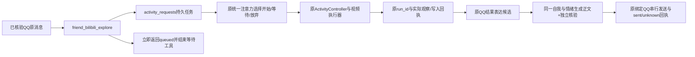

# 运行预算调整与后台视频任务

2026-10-29，companion-adapter 0.20.0，架构 v0.22。按主用户清单调整，预算审计的99组原值保留在27号HTML报告作为变更前快照。

## 当前预算

| 流程 | 当前输出上限 |
|---|---:|
| 活动决定、选片、选窗口、画面理解、阅读反思、经历审核 | 各256,000 tokens |
| 成长、情绪审核 | 8,192 tokens |
| 自主反思、长期目标规划 | 4,096 tokens |
| 主动QQ正文、独立出站核验 | 各4,096 tokens |
| B站交流、社交经历审核 | 各8,192 tokens |

聊天仍使用已核实的1,048,576-token窗口与256,000-token单次输出。输出上限是允许值，不是要求生成这么多。结构化任务仍须返回简短、完整、符合约定的JSON；18,000字符正文合同不限制推理块的同等字符数。

| 运行资源 | 当前值 |
|---|---:|
| 自动探索 / 自动决策 | 6 / 12次每天 |
| 自动活动冷却 | 60分钟 |
| 明确要求的手动浏览 | 30次每天，间隔30秒 |
| 共享记忆应用审核 | 30次每天 |
| 共享成长与情绪审核 | 50次每天 |
| 自我状态常驻选择预算 | 6000字符 |
| 视频观察 | 3窗口，每窗最多60秒、4张采样图 |
| 每轮活动模型调用 | 最多16次（纯字幕旧路径8次） |
| 活动执行时限 | 累计有效执行300秒；被统一注意力暂停的时间不计入 |
| 成长/情绪审核超时 | 60秒 |
| 视频经历审核超时 | 180秒，仍受剩余活动时限约束 |

“可用自我状态6K”按每轮注入的字符预算理解，不是允许同时保存6000项状态。可用状态数量仍为24项，全部历史版本保留。夜间分批、快照、消息节流和来源核验保留有界运行。

## 召回策略

通过公开Mnemon SDK注册`friend-three-tier`，实现位于本插件`vendor/mnemon-three-tier`。基于MIT许可的`dsh-mnemon-strategy-default-three-tier@0.5.11`适配，源码出处与完整许可同目录保留。原第三方node_modules未手改。

普通聊天最多2个不同查询、最多8条证据；复杂的跨事件比较/时间线回顾可说明具体理由，经当前View的recall路由传`intent: "complex:<8–300字符的任务理由>"`申请，最多4个查询、12条证据。普通与复杂、直接召回与图关联共享12,000字符包络，单条最多2000字符。达到字符/条数预算后不再查询Native；相同查询重放原结果，不重复扣文本或访问次数。原质量筛选、来源范围、去重、只读回调与不完整标记继续生效；8/12是上限，不保证每次都有足够相关结果。

策略扩展调整读取配额。原Runtime、文档、Native空间、数据库路径、记忆ID、人格版本和写入保护沿用，未做记忆格式转换。安装器仅在原先选用默认三层策略时切换此策略，不覆盖用户另选的其他策略。

## QQ后台阅读

QQ原回合继续使用180秒普通处理时限，视频工具在QQ返回持久请求ID，不等待300秒浏览流程。后台用服务自己的取消信号运行，原回合正常结束不会取消视频。网页同步阅读入口继续支持等待工具。

新增`activity_requests`一张表，仍在同一`companion.sqlite`中。记录核验的原消息与绑定、完整请求、注意力事项ID、原run_id及结果。相同原消息重放返回原请求；参数被改成另一任务会拒绝。重启核对原检查点并复用run_id，已预留的手动额度、已完成观察和写入回执不会重新创建；不会因无发送回执而重发。

任务结束先保存结果，再产生表达候选，复用现有ProactiveController的正文/核验/串行出站实现；这类候选标记为`requestedReply`，与普通自主分享区分。仍由统一注意力决定何时处理或不回复，不强制聊天优先。请求结果不受普通自主分享5分钟间隔影响；暂停普通主动分享不会阻止先前明确任务的答复。`/stop`或活动取消会取消未执行任务及尚未发送结果；已发送和unknown回执保留原事实。

`learn=false`依旧禁止写入长期记忆、兴趣和情绪，但不禁止回答这条明确请求；观察和操作原件按既有约定留存。没有制造新的主用户消息或把后台结果当新的独立人格依据。实际发送才进入已发上下文，后续接话可以查询。

`friend_activity_status`显示后台队列；`friend_activity_read(requestId=...)`可读具体请求与结果。队列20项，满时明确拒绝新增，不声称已经开始。手动额度耗尽时保留待办到下个资源窗口重新考虑。

## 音频按片段读取

复用已实现的受限Range转发服务读取MP4/AAC音轨。FFmpeg只取得随机本机地址，在输入端seek到窗口并输出有界单声道16k PCM，再交给原faster-whisper。原CDN签名URL、账号Cookie不传入子进程。累计音频读取仍为24MiB，最多96个逻辑Range请求，任务结束/失败/取消关闭转发并清理自有临时文件；平台不支持有效Range时明确失败，不无界下载整条音轨。

真实长视频BV1gf4y1D7cr的1800–1820秒验收：音轨总大小43,179,110字节，仅读取404,531字节，原faster-whisper CPU运行时完成转写。字幕读取成功时仍不额外运行ASR。采样观察不能声称完整连续看过视频。

## 验证边界

已验证隔离数据库中的任务幂等、父回合取消隔离、服务重启续接、取消、额度耗尽保留、无保存请求结果、原绑定发送与重复防护；普通/复杂召回、文本/条数共享、质量和来源范围；真实FFmpeg裁剪192MiB逻辑音轨，真实43MB音轨Range与本地ASR；真实DeepSeek的256,000-token活动审核请求；独立DSH安装新策略并完成真实模型只读召回。

全部测试数量、安装摘要、备份和正式启动核验以根目录`verification.json`及`.work/budget-upgrade-release.json`为准。真实QQ后台收发的延迟与长期自然体验需要后续实际使用观察；本次没有向正式QQ/B站发送验收消息，也没有把验收资料写入正式记忆。

2026-10-29 0.20.1 补充：注意力决策输出上限因真实 max-tokens 失败从3200增至8192 tokens，其余上述预算保持。故障及回归见[调度卡住修复](29-attention-stall.md)。
