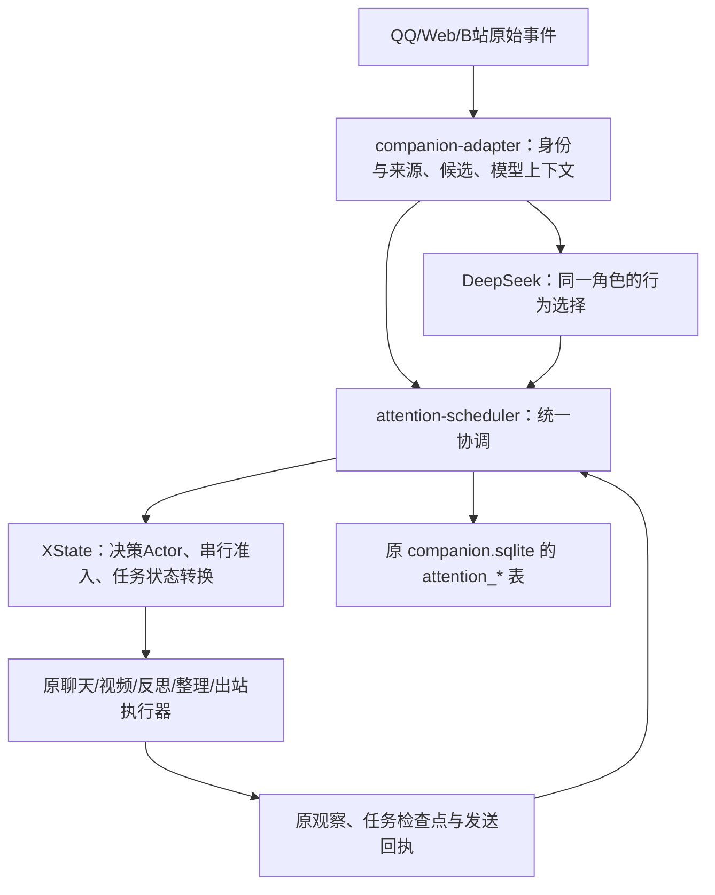

# 独立调度插件与 XState

2026-10-29：companion-adapter 0.21.0，attention-scheduler 0.1.0，XState 5.33.3，架构 v0.23。

## 模块职责

新插件提供 `friendScheduler` DSH 服务，陪伴适配插件通过依赖注入取得服务，调用 `create()` 并注入原模型、语义验证器和执行钩子。通用协调代码已从陪伴模块迁出；`companion-adapter/src/attention.js`、`attention-store.js` 仅保留兼容入口。没有修改 DSH、Mnemon 或 XState 的上游源码。

人格、情绪、兴趣与目标仍归陪伴模块；DeepSeek 结合真实状态选择开始、继续、延后、不回应或安静。状态机只管理执行过程，不预设语气、人格或聊天优先级。

## 复用的能力和我们维护的规则

- XState 决策 Actor 管理单次调用、并发合并、结束及取消，不额外暗中重试模型。
- XState 邮箱按顺序处理执行准入，某项失败后继续下一项；关闭时拒绝尚未开始的工作。
- XState 纯转换根据数据库当前行校验任务状态，已结束任务不能被晚到回调直接复活。核对已中断后台请求后才允许显式重新开放原事项。事务回滚后不持有与数据库冲突的任务快照。
- 同次决策的同步提案与真正外部新事件、活动冷却与额度、来源核验等规则，继续由本项目维护。升级引擎不能替代这些规则的正确实现。
- 保留原后台任务注册、任务面板及用户定时提醒能力。内部等待条件仍以原 SQLite 的绝对到期时间/事件条件为准；到期仅重新开放候选，不自动发消息或启动浏览。
- 关闭时把未完成的模型决策标为中断，防止晚到异步校验在插件销毁后继续提交。已提交决策不被回写成中断。

## 持久化与迁移

持久数据仍在 `D:/ai friend/runtime/dev`，核心协调记录仍是 `companion/companion.sqlite` 的原 `attention_meta`、`attention_intents`、`attention_decisions` 和 `attention_checkpoints`。本次无数据库格式迁移，没有重新创建身份、复制记忆或清空历史。

不把 XState invoke 快照直接恢复运行，避免恢复时重启调用带来重复操作。重启后先把未完事项恢复为待核对，再由原执行器查原会话、run_id、观察和出站回执。发送结果 unknown 时仍不盲重发；记忆写入仍经原审核、快照、CAS 和回执链路。

源码分别在 `plugins/attention-scheduler` 与 `plugins/companion-adapter`。执行用的两个包安装到 `runtime/dev/dsh-home/profiles/web/node_modules/@ai-friend/`。XState 为新调度包的固定 npm 依赖，不单独安装为 DSH 插件。根 package 的开发依赖支持直接运行源码测试；运行实例使用已打包安装的版本。

`scripts/install-adapter.mjs` 会先调用 `install-scheduler.mjs`，分别生成 tgz、SHA256 和安装记录。重复安装保持幂等。迁移继续采用停机运行数据快照，加上源代码及 package/lock 文件，在目标机安装依赖；不能仅复制某个 node_modules 子目录。调度插件是陪伴适配模块的必需服务，缺失时保持未启动，不静默恢复旧调度。

## 验收与限制

完整回归包含原并发空转重现、真实新事件作废、沉默与暂缓、视频续接、QQ/B站出站去重、记忆保护，以及新增 Actor 串行、关闭取消、事务回滚、终态保护和晚到校验隔离。隔离 DSH 实例实际加载两个插件并通过真实 DeepSeek 决策；没有向真实 QQ/B站发验收消息，没有写正式记忆。最终结果见 `.work/xstate-scheduler-release.json`。

仍需持续观察模型理解、自然取舍与多日效果。模型格式校验失败保留原错误及重试保护；XState 不能保证模型永远输出合法参数，也不能解决平台登录失效、接口变化或风控。此次没有增加按账号查询最新投稿的能力。

正式发布验收：631项回归全部通过（0失败、0跳过）；隔离DSH真实DeepSeek决策提交成功；双插件重复安装幂等；正式安装的139+9个文件与候选源码逐项一致。停机快照为 `D:/ai friend/backups/dev/2026-10-29T12-50-19-838Z`，安装前后全部陪伴数据库表、身份、记忆文件和凭据一致。正式Web、Mnemon、两个DSH服务均正常；QQ桥接进程恢复后自动登录AI账号，未发送真实平台验收消息。
