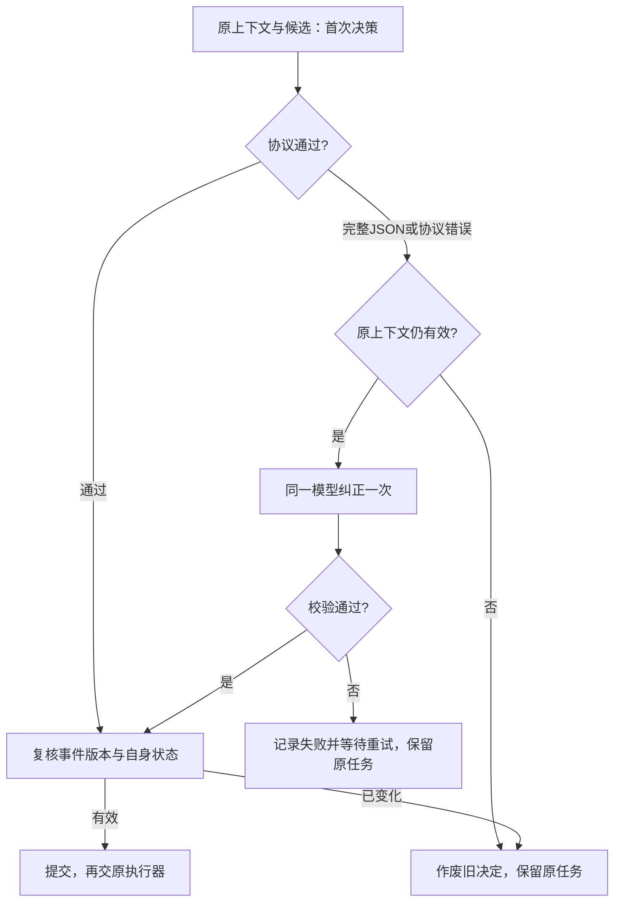

# 决策协议、单次纠正与本地状态查看

2026-10-29：companion-adapter 0.22.0，attention-scheduler 0.2.0，架构 v0.24。XState 保持 5.33.3，统一协议使用固定 Zod 4.6.7。

## 为什么做

旧提示词用 `event|task_end|...` 等伪JSON表达枚举，与实际只允许一个值的校验器分别维护。模型偶尔漏写延后条件、引用不在候选中的目标，导致整次决定失败并进入60秒保护。错误不应被解释为有意沉默。

`companion-adapter/src/attention-protocol.js` 集中定义行为选择协议：action、候选ID、updates、wake和suggestions的字段、枚举及边界。模型收到由此生成的JSON Schema；本地也用同一Zod定义校验，并检查重复ID、start目标不得同时延期等关系。情绪与目标提案仍走原独立审核，不借本次改动直接变更人格。

Schema作为模型输入并进行本地校验，本次没有假设DeepSeek或DSH提供服务端强制结构化输出。

## 一次决定最多两次模型请求

纠正请求携带原上下文、原候选、具体校验错误，以及有界的待纠正输出。要求保留原意；程序不填写目标、唤醒条件或对外回复。首份无效输出的任何状态更新、情绪/目标提案均不执行。最后有效的决定才进入原审批与执行链。

纠正前后都检查事件版本与自身状态；纠正期间有新原件或状态变化时，旧决定失效。初始与纠正共享原90秒超时/取消信号，单次输出上限仍为8192 tokens；正常决定一次请求，触发纠正时最多两次。网络错误、超时、未完成的max-tokens输出、敏感输出不额外当作格式问题重试。两次均无效时记录失败，沿用60秒保护；不会虚构沉默或强制回复。

## 运行事实与查看

新增 `attention_attempts` 表，仍在 `runtime/dev/companion/companion.sqlite`。原 `attention_*` 表、事项ID和检查点保留。每个decision最多initial、repair两行，记录状态、错误、用量、开始/结束时间和输出哈希；不在新表保存原始无效回答或内部推理。两次请求的用量同时计入汇总，原模型诊断观察器也会看到两次实际请求。

重启或关闭时，中断尚未结束的请求记录，不盲重放旧纠正。旧数据库不曾记录分次请求时，查看器保留该事实，不编造历史。

运行根目录 `Attention.cmd`，或 `scripts/attention.mjs`，只读查看：正在决策、正在纠正、主动安静、模型暂缓、等待资源、已选/执行中、处理失败与重试时间。模型可用的原注意力状态工具也增加相同说明。只展示短选择依据和运行事实，不展示内部推理过程，不自动向QQ/B站发送这些诊断。

查看器显示持久化快照；已处理不等于实际送达，仍须看原渠道回执。新等待记录明确标注模型暂缓或资源等待；旧未分类记录显示“等待条件”，不推断为有意沉默。

## 验证与边界

隔离回归覆盖一次纠正成功、两次均失败、完整坏JSON、网络/max-tokens不纠正、敏感内容隔离、原超时、新事件在纠正前/中到达、并发合并、关闭后的晚到回调、用量汇总与只读状态查看。另在独立DSH中实际调用DeepSeek：首轮结果故意注入无效候选ID，再验证一次真实纠正后成功提交。测试没有向真实平台发消息，没有写正式记忆。

这减少格式错误造成的等待，不保证模型永不误解，也不替代权限、来源、发送去重与记忆审核。按账号查询B站最新投稿仍是下一项能力缺口，本次没有扩展它。

正式发布验收：647项回归全部通过（0失败、0跳过）；隔离DSH真实模型故障注入验证两次请求（initial invalid、repair completed）；正式两个插件均active，152个安装文件与候选逐项一致，重复安装幂等。快照为 `D:/ai friend/backups/dev/2026-10-29T13-28-53-288Z`。安装前后原陪伴数据库表、身份、记忆文件和凭据一致；启动后新增attention_attempts记录分次请求。正式QQ连接、记忆服务与只读查看器正常，已有自然决策成功提交，未向真实平台发送验收消息。
