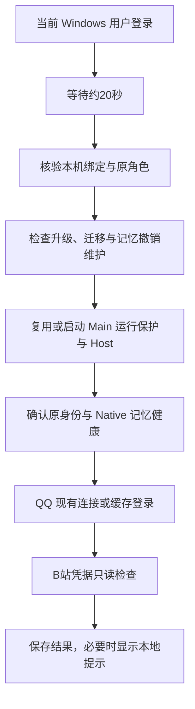

# Windows 用户登录后自启与平台登录检查

架构 v0.35，自启工具 1.0.0。复用现有 Main 启动器、运行保护和平台登录组件；不新增 AI 决策循环或更换记忆／人格模块。公司当前保持手动启动。

## 职责与顺序

`Enable-Autostart.cmd` 只注册和启用计划任务，不即时拉起实例。任务只适用于当前电脑、当前 Windows 用户和 Main。主角色仍在 `runtime/dev`，Test 仍手动运行。启用后手动 `Stop-Main` 会暂停自启，直到再次 `Start-Main`、`Restart-Dev`、`Recover-Main` 或重新启用；停用自启不会停止正在运行的 Main。

任务使用当前用户的交互式普通权限，不保存 Windows 密码、不申请管理员权限。AtLogOn 触发器延迟 20 秒，重复触发采用 IgnoreNew；不要求联网才启动，允许电池供电。执行时限显式设为 `PT0S`，避免默认 72 小时限制终止长期开启的任务及其进程；真正的运行恢复仍由原运行保护负责。普通任务动作完成后 Main 仍能继续运行，已在真实 Windows 任务中验证。

## 平台边界

QQ 先通过本机 OneBot 检查实际登录 UID。已有正确账号即复用；没有连接且没有冲突的 QQ 时，调用原 `QQ.ps1 Start -NoBrowser` 尝试缓存快捷登录。检测到个人 QQ 或其他账号时保留现场，不强杀、不自动退出。只有 NapCat 明确返回等待扫码／二维码过期等状态才提示扫码；初始化、重连、接口故障不会一律当成登录失效。NapCat WebUI 凭据只在进程内临时使用，不记录二维码 URL 或认证值。

B站通过官方 nav 接口只读核验已存 Cookie 的 UID。认证失效、账号不符、网络不可达、平台验证分别报告。有效的基础登录和公开评论所需网页会话分开检查；辅助票据过期不直接判成整个账号退出。不刷新 Cookie、不绕过验证、不进行外部发言。每次检查本身不请求模型生成，也不写人格或长期记忆。

普通手动 `Start-Main` 的平台启动流程沿用原行为；自动尝试 QQ 缓存登录和聚合提示属于本次登录自启流程。`Open-QQ-Login.cmd` 只是需要时打开现有登录页。

## 数据、归属与并发

| 文件 | 职责 |
| --- | --- |
| `runtime/dev/operations/autostart.local.json` | 本机启用／暂停、版本号、SID、机器绑定、原角色 UUID、原路径及任务名；无账号密码 |
| `runtime/dev/operations/autostart-status.json` | 最近一次检查阶段和脱敏结果 |
| `runtime/dev/operations/autostart-run.json` | 当前执行者 PID、随机令牌与 Windows 启动批次，避免重复执行 |
| `runtime/dev/host.json`、`host.lock`、`operations/guard.json` | 原控制记录，新增启动批次标记；控制令牌与管道沿用 |

任务名根据本地绝对路径和当前 SID 派生；修改同名任务前核验用户、动作与项目说明，不覆盖其他人的任务。配置还绑定机器及原角色 UUID；文件迁移不等于 OS 任务迁移，新电脑要明确重新启用。启动只核验已有数据库、bootstrap 和固定依赖，不用缺失的数据目录生成替代角色。

执行前后核验配置版本，手动暂停可取消尚未完成的拉起。正在升级、迁移或有未完成的记忆撤销时阻止启动。已健康的 Main 复用；活着但归属或控制通道不明的进程保留现场。

Windows 重启可能复用旧 PID，因此新进程记录附带由 MachineGuid 和系统启动时间派生的批次哈希。只有两个合法批次明确不同时才把旧记录判为失效；读取失败或旧记录没有批次时保守处理。发布时对当前仍运行的 Host／guard 先用原令牌核验 PID、启动时间、路径与角色，再补充批次字段，不重启或更换控制令牌。这个标记只处理运行记录，不修改角色数据。

## 验证与未覆盖范围

最终 903 项回归通过，其中包含 30 项自启与平台状态测试，以及两项跨启动批次的进程记录测试。测试覆盖手动暂停、停用不停机、重复执行、维护阻断、机器／身份不符、缺少数据不重建、启动竞争、未知活进程保留、QQ 账号及初始化分类、B站网络／认证／评论会话分类。

在本机实际注册临时 Windows 任务，核验 Interactive／Limited／IgnoreNew／PT0S 并执行成功，随后停用并移除。另以独立身份和端口的真实 DSH／Native 验证：任务启动、启动器完成后服务继续运行、手动停止阻止再次启动、重新启用续用原身份、停用自启不停止 Main。演练任务已移除，演练模型凭据已清理；没有向 QQ／B站发送消息，也没有请求模型生成。

这些结果不替代家用电脑的迁移、实际 Windows 注销／重启及真实 QQ 缓存登录验收。平台登录期限由平台决定；不能承诺每次重启都无需扫码。

入口说明见项目根目录 [自启动说明](../自启动说明.md)。发布与演练记录保存在 `.work/autostart-release.json`、`.work/autostart-integration.json` 和 `.work/autostart-task-smoke.json`。

## 参考

- [Microsoft：任务运行的安全上下文](https://learn.microsoft.com/en-us/windows/win32/taskschd/security-contexts-for-running-tasks)
- [Microsoft：任务主体与交互式登录](https://learn.microsoft.com/en-us/powershell/module/scheduledtasks/new-scheduledtaskprincipal)
- [Microsoft：ExecutionTimeLimit 默认值及 PT0S](https://learn.microsoft.com/en-us/windows/win32/taskschd/tasksettings-executiontimelimit)
