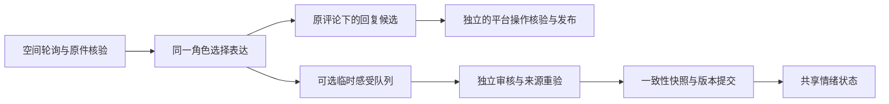

# QQ空间评论的临时感受

适用版本：companion-adapter 0.52.0、qq-bridge 0.15.0。B站插件维持原有实现。

## 行为与职责

空间评论的正常表达模型可在同一次JSON中附0–4项 `emotionProposals`。它仍可回复、暂缓、忽略，亦可完全不改变感受。非空提案复用现有独立情绪审核、共享日额度、版本核验及写前一致性快照，审核在表达之外执行。无效可选感受字段单独拒绝，不让合规的文本回复候选失败。

感受只基于实际收到和读取的评论，不要求回复已发表。`proposed`仅表示回复候选，不能当作已说过、对方已读或双方达成约定。长期兴趣、性格、自我描述和个人提示词继续走原深度评价路径。

## 来源和可见范围

- 新情绪引文只允许逐字来自当前评论正文。原说说文字和直接上级评论是按作者标注的有界语境，不冒充本轮评论者的新原话；未读图片不推断画面。
- 捕获原说说最多1200字符、直接上级评论最多700字符，并记录完整文字哈希或原评论哈希。上级评论不在预览中时明确标为未知，不把其他评论混进当前依据。
- 表达历史只取同一可见范围、且当前页面仍可核验的先前原评论；不把缓存中的私密范围或待发回复混进当前历史。复用本次已核验页面缓存准备表达上下文；审核及提交前后使用新读取核对当前评论、账号、可见范围、语境和已引用称呼。语境变化或不可验证时不提交新感受。
- 现有来源支持公开、好友、仅自己三类范围，原件范围不自动扩大。来源不支持、禁存、测试或只读要求下允许普通交流，但不登记情绪变化。
- 只有同一个QQ号、同一可见范围且本轮实际召回的有效称呼偏好，才能作为辅助审核背景；空间可跨同范围说说使用既有称呼。私人聊天或另一可见范围的称呼不会被补进来。称呼背景不能作为新情绪依据或权限证明。

## 去重、失效与恢复

空间使用独立的新事件基线，升级前排队评论不补学。单条原件最多登记一次非空提案，暂缓后不重复送审。现有队列上限100、提案15分钟到期、共享成长/情绪审核默认每日50次及8192 tokens输出预算保持。

同发送者、同说说、同可见范围的接收顺序短对话共用窗口；20分钟静默或一小时总跨度后开启新窗。不同作者、说说、私聊或可见范围分开。即时感受与深度评价共享因果键和窗口，重复依据不能提高程度、刷新时效或增加独立支持。空间窗口只用于独立性计数，本轮没有新增空间多轮语义关联或纠正模型。

轮询与当前页面核验若确实读到评论文字改动，会更新来源状态，使受影响感受退出当前使用，历史版本保留。每页最多50条评论、每个说说最多检查最近200条已收事件；预览里没有某条评论不等于已经删除，不能据此抹掉历史。提交新感受时仍要求原评论当前可核验。

停机或崩溃仅核对已存在的审核回执，不重放对外消息或模型。空提案没有新增审核调用、快照或队列记录；正常发布沿用原空间操作链路。

## 存储与迁移

继续使用 `runtime/dev/companion/companion.sqlite`：原 `platform_events` 保存评论，`social_chat_emotion_jobs` 保存提案、冻结来源哈希、称呼引用与实际回执，原情绪表保存状态和版本。仅新增元数据基线键 `space-chat-emotion-cutoff`，没有新增人格库或数据库表。原一致性快照仍位于 `companion/protection/qq-social`。完整停写实例的迁移方式保持。

## 验证边界

隔离验证覆盖回复候选与发表的区别、忽略/暂缓感受、空提案和无效提案、禁存、原件/语境/可见范围变化、跨人跨范围称呼、快照失败、短窗去重、深度评价重复强化、异常事件状态、旧评论基线、页面可见编辑及预览缺失。

真实模型验证在隔离实例使用合成说说和评论，不向实际QQ空间发布，也不写入生产角色；实际发布是否可见必须另外按真实回执与用户确认记录。零变化是合法结果，不要求角色为验收产生某种情绪。

## 发布验证

0.52.0源码1694项回归全部通过；实际安装包457项相关回归通过，新增37项空间专项测试。5组官方DeepSeek隔离验证通过，其中4组使用实际空间表达回调，1组使用合成表达候选与实际独立审核；候选未提交真实空间。
四个插件的源码与实际安装产物一致，原身份、自我及情绪版本历史、事件原文完整保留，原QQ聊天基线保留且未新建数据库表。空间临时感受新基线为事件行57，旧评论不会补学。
AI QQ3197399707连接正常，现有公开说说“想看看今天的云”可以实际读取，真实新评论的表达及非空感受审核结果见下方验收记录。
证据：.work/qzone-chat-emotion-acceptance.json；.work/qzone-chat-emotion-postcheck.json。

## 真实空间验收（2026-11-03）

主QQ1792879730在原公开说说下发布“如果我是dj，你还会爱我吗”。新事件为行58，晚于本版基线57；项目经正常轮询收到，没有重放旧评论或代替用户发言。
她选择回复“会呀，老爹。不过我得先问一句：你当DJ的话，打碟时会把云放在哪首曲子里？”。实际操作已提交一次，原评论线程读到AI账号发给该评论者的完全匹配文本。API返回的评论ID与页面局部序号尚未严格映射，因此只记录接口受理与原线程观察，不将其标记为已证明API归属。主用户已明确确认手机可见。
同次表达自主提出一项“被歌词梗逗到的一点好笑”。独立审核依据当前原话及反例，接受为轻微、短暂、判断把握中等的感受；没有把歌词问题升级为正式表白或固定关系。情绪版本从9到10，角色总状态版本从15到16。只有1个新情绪版本、1份独立支持；同一事件的深度评价选择沉默，未重复强化。
实际审核请求的来源哈希已与冻结提案逐项核对。原说说文字仅标为context，新引文仅来自本次评论；“老爹”辅助材料来自同一QQ、公开空间范围既有有效称呼，而非私人聊天。审核没有把待发回答当成已经发表的证据。
一致性快照SHA-256、文件大小及内容均已核验：快照情绪版本为9，不包含新情绪版本；原身份、升级前自我/情绪版本和经历原文保持完整，没有新增表。记录仍位于runtime/dev/companion/companion.sqlite，写前快照位于companion/protection/qq-social。
本次真实覆盖为1条公开根评论、正常回复和1项非空感受的实际审核落库。楼中楼语境、好友/仅自己范围、忽略/暂缓、来源改动与重启等分支属于隔离验证范围，本次没有逐一在真实空间制造。零变化仍是合法结果，不要求后续每条评论都有感受。
证据：.work/qzone-chat-emotion-live-acceptance.json；.work/qzone-chat-emotion-acceptance.json。
